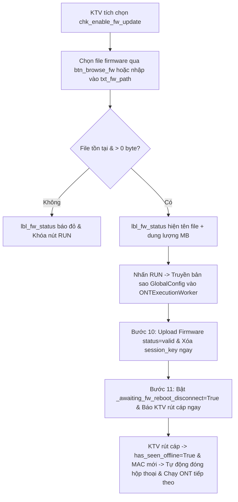

# Phase 2: UI Controls, Worker & Hot-Swap Probe Handling

## Overview
Bổ sung giao diện tùy chọn Update Firmware (checkbox bật/tắt + ô đường dẫn file firmware + nút chọn file) vào `MainWindow` (`app/ui/main_window.py`), cập nhật `ONTExecutionWorker` (`app/ui/worker.py`) và cơ chế chống nhận nhầm thiết bị vừa reboot trong `NetworkProbe` (`app/core/network_probe.py`) để KTV có thể rút cáp cắm sang ONT khác làm tiếp ngay lập tức.

## Requirements
- **Functional:**
  - Trên cột phải (`settings_container`) của `MainWindow`, thêm nhóm `QGroupBox("Cập Nhật Firmware Tự Động (Tùy Chọn)")` gồm:
    - `self.chk_enable_fw_update = QCheckBox("Update Firmware ở bước cuối cùng")` (mặc định `False`).
    - Hàng chọn file gồm `self.txt_fw_path = QLineEdit()` + nút `self.btn_browse_fw = QPushButton("Chọn...")` mở `QFileDialog.getOpenFileName` lọc `Firmware Files (*.signed *.signed.* *.bin *.img);;All Files (*)` (`[Red Team RT-06]`).
    - Nhãn trạng thái file `self.lbl_fw_status = QLabel(...)` hiển thị dung lượng file (MB) màu xanh khi hợp lệ hoặc cảnh báo màu đỏ khi bật checkbox nhưng chưa chọn file / đường dẫn không tồn tại.
    - Khi khởi tạo `MainWindow`, nếu trong thư mục gốc ứng dụng (`get_app_base_dir()`) có sẵn file khớp `*.signed` hoặc `*.signed.*` (ví dụ `GX40E5VN0T0201_260421_142142.signed` hoặc `tclinux.bin.signed.*`), tự động gợi ý sẵn đường dẫn file mới nhất (theo `os.path.getmtime`) vào `self.txt_fw_path`, đồng thời `chk_enable_fw_update` mặc định là `False` khi mở app và giữ nguyên trạng thái KTV đã chọn xuyên suốt các thiết bị tiếp theo trong phiên làm việc. <!-- Updated: Validation Session 1 - Confirmed default unchecked state persisted across session & mtime-sorted auto-detect -->
  - Ràng buộc nút `RUN`, khóa control khi đang chạy, và snapshot `GlobalConfig` (`[Red Team RT-06]`):
    - Trong `_update_run_button_state()`: khi `self.active_worker and self.active_worker.isRunning()`, khóa (`setEnabled(False)`) cả `chk_enable_fw_update`, `txt_fw_path`, và `btn_browse_fw`; mở khóa lại khi worker kết thúc. Nếu `chk_enable_fw_update.isChecked()` là `True` mà `not self._is_firmware_file_valid()`, đặt `can_run = False`.
    - Trong `_maybe_auto_run_next_device()`: nếu `self.chk_enable_fw_update.isChecked() and not self._is_firmware_file_valid(): return`.
    - Trong `run_current_device()`: truyền bản sao độc lập `dataclasses.replace(self.global_cfg)` vào `ONTExecutionWorker` để tránh race condition giữa luồng GUI và luồng Worker.
  - Che thông tin nhạy cảm & xử lý hủy trong `ONTExecutionWorker` (`app/ui/worker.py`) (`[Red Team RT-01, RT-05]`):
    - Bổ sung mẫu regex `(r'("sessionKey"\s*:\s*")([^"]+)', r'\1***')` vào `mask_sensitive_credentials()`, và gán `message = mask_sensitive_credentials(str(e))` khi xử lý ngoại lệ trong `ONTExecutionWorker.run()`.
    - Trong `progress_callback` của `ONTExecutionWorker.run()`, chỉ ném `RuntimeError("Tiến trình đã bị người dùng hủy bỏ (Cancelled).")` khi `self._is_cancelled and status == "RUNNING"` (trước khi bước đó thực thi), không hủy ngang sau khi Bước 10 đã hoàn tất nạp firmware (`status == "SUCCESS"`).
  - Xử lý cửa sổ 14 giây `uHTTPd` còn sống trước khi reboot & chống chạy đè khi ONT vừa nâng cấp tự khởi động lại xong (`NetworkProbe` + `MainWindow`) (`[Red Team RT-02]`):
    - Trong `NetworkProbe.reset()`: sau khi lưu `if self._current_mac: self._last_reset_mac = self._current_mac`, bắt buộc đặt `self._current_mac = None`. Trong `probe_once()`: gán `self._current_mac = self._get_gateway_mac()` trực tiếp và neo regex `arp -a` theo đúng IP `host` với `timeout=1.0`.
    - Bổ sung property `is_same_device_as_last_reset(self) -> bool`: trả về `bool(self._current_mac and self._last_reset_mac and self._current_mac == self._last_reset_mac)`.
    - Trong `MainWindow`: thêm cờ `self._awaiting_fw_reboot_disconnect: bool = False`. Khi `_on_worker_finished` hoàn tất thành công với `result.get("firmware_updated") == True`, bật `self._awaiting_fw_reboot_disconnect = True`. Cờ này chỉ tắt về `False` khi `self.probe.has_seen_offline and not self.probe.is_same_device_as_last_reset` (tức là ONT cũ đã thực sự ngắt kết nối/rút cáp và thiết bị đang kết nối không phải là cùng chiếc ONT cũ vừa reboot xong).
    - Trong `_on_probe_status_changed()`: chỉ tự động đóng `_completion_msg_box.accept()` khi `self.probe.has_seen_offline and not self.probe.is_same_device_as_last_reset`.
    - Trong `_update_run_button_state()` và `_maybe_auto_run_next_device()`: nếu `self._awaiting_fw_reboot_disconnect` đang `True` (hoặc `self.probe.is_same_device_as_last_reset` là `True`), chặn `can_run` / tự động chạy tiếp để tránh bấm `RUN` nhầm vào ONT #1 trong 14 giây đầu khi nó đang ghi flash hoặc sau 2 phút khi nó vừa reboot xong mà KTV chưa rút cáp.
- **Non-functional:**
  - Không làm thay đổi kích thước tổng thể của cửa sổ hay ảnh hưởng tới bố cục bảng 10 cột bên trái.
  - Đảm bảo phím tắt `Space` / `Enter` không kích hoạt nhầm `RUN` khi con trỏ đang nằm trong `self.txt_fw_path`.

## Architecture

## Related Code Files
- Modify: `app/ui/main_window.py`
- Modify: `app/ui/worker.py`
- Modify: `app/core/network_probe.py`

## Implementation Steps
1. Trong `app/core/network_probe.py`:
   - Trong `reset()`: đặt `self._current_mac = None` sau khi lưu `self._last_reset_mac`.
   - Trong `_get_gateway_mac()`: neo regex theo `host` (`rf"{re.escape(host)}\s+([0-9a-fA-F]{{2}}(?:-[0-9a-fA-F]{{2}}){{5}})"`) và tăng `timeout=1.0`.
   - Trong `probe_once()`: cập nhật `self._current_mac = self._get_gateway_mac()`.
   - Bổ sung property `is_same_device_as_last_reset(self) -> bool`: trả về `bool(self._current_mac and self._last_reset_mac and self._current_mac == self._last_reset_mac)`.
2. Trong `app/ui/worker.py`:
   - Thêm `(r'("sessionKey"\s*:\s*")([^"]+)', r'\1***')` vào `mask_sensitive_credentials()`.
   - Trong `ONTExecutionWorker.run()`: chỉ kiểm tra `if self._is_cancelled and status == "RUNNING": raise RuntimeError(...)`; cập nhật `message` khi thành công có `result.get("firmware_updated")` thành `f"Cấu hình & Nạp Firmware ({result.get('firmware_file', '')}) thành công 11/11 bước!"`; và mask `message = mask_sensitive_credentials(str(e))` trong khối `except`.
3. Trong `app/ui/main_window.py`:
   - Khởi tạo `self._awaiting_fw_reboot_disconnect: bool = False` trong `__init__`.
   - Trong `_build_ui()`, dưới `grp_settings` trong `settings_layout`, thêm `grp_fw = QGroupBox("Cập Nhật Firmware Tự Động (Tùy Chọn)")` gồm `chk_enable_fw_update`, `txt_fw_path`, `btn_browse_fw`, `lbl_fw_status`.
   - Thêm `_is_firmware_file_valid()`, `_auto_detect_default_firmware()` (hỗ trợ cả `*.signed` và `*.signed.*`), `_browse_firmware()`, và `_on_fw_config_changed()`.
   - Trong `_on_probe_status_changed()`:
     - Nếu `is_online and self.probe.has_seen_offline and not self.probe.is_same_device_as_last_reset`: đặt `self._awaiting_fw_reboot_disconnect = False`.
     - Điều kiện tự đóng `_completion_msg_box.accept()` bổ sung `and not self.probe.is_same_device_as_last_reset`.
   - Trong `_update_run_button_state()`:
     - Khi worker đang chạy: disable `chk_enable_fw_update`, `txt_fw_path`, `btn_browse_fw`; khi worker dừng: enable lại `chk_enable_fw_update` và enable `txt_fw_path`/`btn_browse_fw` theo `chk_enable_fw_update.isChecked()`.
     - Nếu `self.chk_enable_fw_update.isChecked() and not self._is_firmware_file_valid()`: `can_run = False`.
     - Nếu `self._awaiting_fw_reboot_disconnect and (not self.probe.has_seen_offline or self.probe.is_same_device_as_last_reset)`: `can_run = False`.
   - Trong `_maybe_auto_run_next_device()`:
     - Kiểm tra `if self.probe.is_same_device_as_last_reset or self._awaiting_fw_reboot_disconnect: return` và `if self.chk_enable_fw_update.isChecked() and not self._is_firmware_file_valid(): return`.
   - Trong `run_current_device()`:
     - Kiểm tra `if self.chk_enable_fw_update.isChecked() and not self._is_firmware_file_valid():` hiện `QMessageBox.warning` và return.
     - Đặt `self._awaiting_fw_reboot_disconnect = False`, đồng bộ `self.global_cfg.enable_firmware_update` và `self.global_cfg.firmware_path`, đặt `self.progress_bar.setRange(0, 11 if self.global_cfg.enable_firmware_update else 10)`, và truyền `dataclasses.replace(self.global_cfg)` vào `ONTExecutionWorker`.
   - Trong `_on_worker_finished()`:
     - Lấy `fw_updated = bool(result.get("firmware_updated"))`. Nếu `success and fw_updated`: đặt `self._awaiting_fw_reboot_disconnect = True`.
     - Gọi `self._show_completion_dialog(slid, firmware_updated=fw_updated)` (`[Red Team RT-06]`).
   - Trong `_show_completion_dialog(self, slid: str, firmware_updated: bool = False)`: hiển thị nội dung hướng dẫn rút cáp nóng ngay khi `firmware_updated=True`.

## Todo
- [x] Cập nhật `NetworkProbe.reset()`, `_get_gateway_mac()`, `probe_once()` và thêm `is_same_device_as_last_reset` (`app/core/network_probe.py`)
- [x] Cập nhật `mask_sensitive_credentials()` và `ONTExecutionWorker.run()` (`app/ui/worker.py`)
- [x] Bổ sung nhóm UI `Cập Nhật Firmware Tự Động (Tùy Chọn)` và xử lý `_awaiting_fw_reboot_disconnect`, snapshot `GlobalConfig`, `_show_completion_dialog(slid, firmware_updated=...)` trong `MainWindow` (`app/ui/main_window.py`)

## Success Criteria
- [x] Checkbox bật/tắt và ô chọn file firmware hoạt động mượt mà trên giao diện `MainWindow` và tự động khóa khi tiến trình đang chạy.
- [x] Khi bật checkbox mà đường dẫn file rỗng hoặc không tồn tại, nút `RUN` bị khóa và `run_current_device()` cảnh báo rõ ràng.
- [x] Khi hoàn tất cả cấu hình + update firmware, thanh tiến trình đạt `11/11`, cờ `_awaiting_fw_reboot_disconnect` khóa nút `RUN` trong cửa sổ 14s trước khi ONT cũ tắt `uHTTPd`, hộp thoại thông báo cho phép rút cáp ngay và tự động đóng khi cắm ONT mới.

## Risk Assessment
- **Rủi ro (Cửa sổ 14s `uHTTPd` còn sống trước khi reboot và trường hợp ONT#1 tự reboot xong sau 2 phút mà KTV chưa rút cáp):**
  - *Giải pháp:* Kết hợp cờ `_awaiting_fw_reboot_disconnect` (bắt buộc phải qua ít nhất 1 lần offline sau khi nạp firmware) và `self.probe.is_same_device_as_last_reset` (dựa trên ARP MAC) để chặn cả cửa sổ 14s đầu lẫn trường hợp cùng chiếc ONT#1 khởi động lại xong sau 2 phút (`[Red Team RT-02]`).
