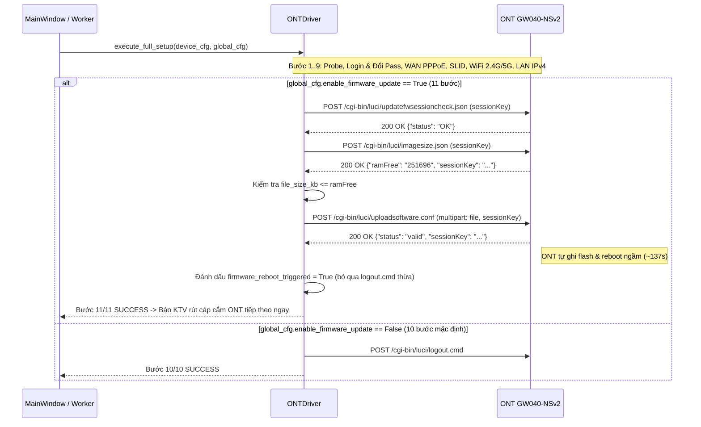

# Kế Hoạch: Bổ Sung Bước Update Firmware Tự Động Ở Cuối Quy Trình Cấu Hình ONT (`app/` Windows)

## Overview
Từ kết quả phân tích bản ghi giao thức thực tế `update_firmware_040nsv2.jsonl` của thiết bị **VNPT iGate GW040-NSv2**, quy trình nâng cấp Firmware (`Update Software`) trên LuCI gồm 3 bước tuần tự:
1. `POST /cgi-bin/luci/updatefwsessioncheck.json` (`sessionKey=<token>`) → `{"status": "OK"}`
2. `POST /cgi-bin/luci/imagesize.json` (`sessionKey=<token>`) → `{"ramFree": "251696", "sessionKey": "<token>"}` (kiểm tra dung lượng file KB so với RAM trống)
3. `POST /cgi-bin/luci/uploadsoftware.conf` (`multipart/form-data` gồm `file` và `sessionKey`) → `{"status": "valid", "sessionKey": "<token>"}`

Ngay khi `uploadsoftware.conf` trả về `{"status": "valid"}` (~11.7 giây truyền file + kiểm tra chữ ký), ONT tự động ghi flash và khởi động lại ngầm (~2 phút 17 giây) mà không cần giữ kết nối với máy tính.

Kế hoạch này bổ sung bước **Update Firmware** vào **bước cuối cùng** của ứng dụng Windows (`app/`):
- **Tùy chọn linh hoạt trên UI (`MainWindow`)**: Cung cấp checkbox **"Cập nhật Firmware ở bước cuối cùng"** kèm ô nhập/hiển thị đường dẫn (`QLineEdit`) và nút **"Chọn..."** (`QFileDialog`).
- **Thực thi sau khi đổ xong cấu hình (`ONTDriver`)**: Sau khi hoàn tất 9 bước đổ cấu hình (WAN PPPoE, GPON SLID, Wi-Fi 2.4G/5G, LAN IPv4, đo kiểm/đồng bộ — toàn bộ đã được commit vào flash), nếu checkbox được tích chọn, driver thực hiện Bước 10 (`Nâng cấp Firmware`) rồi kết thúc ở Bước 11 (`Hoàn tất & Tự động Khởi động lại ONT`).
- **Rút cáp làm tiếp ngay (`Fire-and-Forget`)**: Ngay khi ONT xác nhận `"status": "valid"`, phần mềm báo hoàn tất ngay lập tức (không chờ 2 phút ONT reboot) để KTV rút cáp mạng ra cắm sang ONT tiếp theo làm tiếp, đồng thời chống tự động chạy lặp lại nhầm nếu cáp vẫn cắm trên ONT vừa nâng cấp khi nó khởi động xong.

---

## Scope Challenge Summary
- **Existing code:** `app/core/ont_driver.py` (`ONTDriver.execute_full_setup`), `app/core/config_models.py` (`GlobalConfig`), `app/ui/main_window.py` (`MainWindow`), `app/ui/worker.py` (`ONTExecutionWorker`), `app/core/network_probe.py` (`NetworkProbe`).
- **Requested scope:** Bổ sung tùy chọn checkbox + chọn đường dẫn file firmware trên bản Windows (`app/`), thực thi update firmware ở bước cuối cùng sau khi đổ cấu hình thành công, cho phép rút cáp cắm ONT khác làm tiếp ngay.
- **Complexity:** Chỉnh sửa 5 file trong `app/` và 4 file kiểm thử trong `tests/`, không phát sinh thư viện phụ thuộc ngoài.
- **Selected mode:** `HOLD SCOPE` (`fast` mode — đặc tả giao thức đã có đầy đủ từ `update_firmware_040nsv2.jsonl`).

---

## Goals

| # | Goal | Priority |
|---|------|----------|
| 1 | Mở rộng `GlobalConfig` và `ONTDriver` để hỗ trợ kiểm tra RAM trống và tải lên file Firmware qua `multipart/form-data` ở bước cuối cùng của `execute_full_setup` | P1 |
| 2 | Bổ sung khung điều khiển "Cập Nhật Firmware Tự Động" (Checkbox bật/tắt + Ô nhập Path + Nút Browse) trên `MainWindow` và phối hợp `NetworkProbe` cho phép rút cáp cắm ONT kế tiếp ngay | P1 |
| 3 | Mở rộng `MockLuCIServer` và bộ kiểm thử tự động (`test_ont_driver_mock.py`, `test_ui_components.py`, `test_e2e_workflow.py`) bao phủ luồng bật/tắt update firmware và các trường hợp lỗi | P1 |

---

## Architecture & Sequence Flow

---

## Phases

| # | Phase | Status |
|---|-------|--------|
| 1 | [Phase 1: Core Driver & Config Models Firmware Update](./phase-01-start.md) | Completed |
| 2 | [Phase 2: UI Controls, Worker & Hot-Swap Probe Handling](./phase-02-ui-and-worker-integration.md) | Completed |
| 3 | [Phase 3: Mock LuCI Server & Automated Tests](./phase-03-mock-server-and-tests.md) | Completed |

---

## Cross-Plan Dependencies

| Relationship | Plan | Status |
|-------------|------|--------|
| None | — | — |

---

## Success Criteria
- [x] Khi **không tích chọn** checkbox Update Firmware (mặc định): quy trình giữ nguyên 10/10 bước, tương thích ngược 100% với mọi kịch bản hiện có.
- [x] Khi **tích chọn** checkbox Update Firmware: kiểm tra hợp lệ đường dẫn file firmware trước khi cho phép chạy; thực hiện đầy đủ 11/11 bước (`updatefwsessioncheck.json` → `imagesize.json` → `uploadsoftware.conf`).
- [x] Ngay sau khi `uploadsoftware.conf` trả về `{"status": "valid"}`, `self.session_key` được xóa ngay trong `update_firmware()` (tránh gửi `logout.cmd` thừa ngay cả khi user nhấn Cancel trong lúc đang truyền file `[Red Team RT-01]`), tiến trình hoàn tất ngay lập tức (không chờ ONT khởi động lại), phát âm báo và hiển thị thông báo cho phép KTV rút cáp cắm sang ONT tiếp theo.
- [x] Chống bật nút `RUN` sớm trong cửa sổ ~14 giây khi `uHTTPd` của ONT cũ chưa tắt hẳn và chống tự động chạy đè cấu hình tiếp theo nếu KTV quên chưa rút cáp khỏi ONT vừa nâng cấp khi thiết bị đó khởi động lại xong sau 2 phút (`_awaiting_fw_reboot_disconnect` + ARP MAC `is_same_device_as_last_reset` `[Red Team RT-02]`).
- [x] Toàn bộ unit tests và E2E tests trong `tests/` vượt qua 100%.

---

## Red Team Review

### Session — 2026-10-26
**Findings:** 6 (6 accepted, 0 rejected)
**Severity breakdown:** 2 Critical, 3 High, 1 Medium

| # | Finding | Severity | Disposition | Applied To |
|---|---------|----------|-------------|------------|
| RT-01 | Race condition khi nhấn `Cancel`/`closeEvent` trong lúc upload firmware (~12s) khiến `emit()` ném `RuntimeError` sau khi ONT đã bắt đầu flash (`status == "valid"`), dẫn đến gọi `logout.cmd` thừa và báo `FAILED` sai | Critical | Accept | Phase 1, Phase 2 |
| RT-02 | Cửa sổ ~14 giây `uHTTPd` còn sống sau `uploadsoftware.conf` và thiếu kiểm tra `is_same_device_as_last_reset` ở `_on_probe_status_changed` (`_completion_msg_box.accept()`) + thiếu xóa `_current_mac = None` trong `NetworkProbe.reset()` | Critical | Accept | Phase 2, Phase 3 |
| RT-03 | `MockLuCIHandler.do_POST` đọc `.decode("utf-8", errors="ignore")` và `urllib.parse.parse_qs` làm hỏng dữ liệu nhị phân `multipart/form-data` của `uploadsoftware.conf` | High | Accept | Phase 3 |
| RT-04 | `ONTDriver.update_firmware()` cần kiểm tra JSON `status == "OK"` của `updatefwsessioncheck.json`, chặn khi `ramFree == 0` hoặc thiếu, cập nhật `sessionKey` xoay vòng trước khi raise lỗi `status != "valid"`, và bọc `RequestException`/`ValueError` | High | Accept | Phase 1, Phase 3 |
| RT-05 | Chuẩn hóa tên file multipart `filename` chống ký tự lạ, che `"sessionKey": "..."` dạng JSON trong `mask_sensitive_credentials()`, và phân biệt rõ thông báo lỗi ở Bước 10 sau khi Bước 1–9 đã lưu cấu hình | High | Accept | Phase 1, Phase 2, Phase 3 |
| RT-06 | Snapshot `dataclasses.replace(self.global_cfg)` khi khởi tạo worker, khóa cụm control Firmware khi worker đang chạy, cập nhật callsite `_show_completion_dialog(slid, firmware_updated=...)` và hỗ trợ mẫu file `*.signed*` | Medium | Accept | Phase 1, Phase 2, Phase 3 |

### Whole-Plan Consistency Sweep
- Files reread: `plan.md`, `phase-01-start.md`, `phase-02-ui-and-worker-integration.md`, `phase-03-mock-server-and-tests.md`
- Decision deltas checked: 6 (`RT-01`..`RT-06`)
- Reconciled stale references: 6
- Unresolved contradictions: 0

---

## Validation Log

### Session 1 — 2026-10-26
**Trigger:** Post-Red-Team critical questions interview (`/ak:plan validate`)
**Questions asked:** 3

### Verification Results
- **Tier:** Standard (3 phases: Fact Checker + Contract Verifier)
- **Claims checked:** 30
- **Verified:** 30 | **Failed:** 0 | **Unverified:** 0

#### Questions & Answers

1. **[Assumptions]** Khi mới mở ứng dụng, nút tích chọn "Update Firmware ở bước cuối cùng" nên có trạng thái mặc định như thế nào?
   - Options: Mặc định Tắt khi mở app, giữ trạng thái theo phiên (Recommended) | Tự động Bật nếu có sẵn file firmware trong thư mục tool
   - **Answer:** Mặc định Tắt khi mở app, giữ trạng thái theo phiên
   - **Rationale:** Đảm bảo an toàn tuyệt đối khi KTV chỉ muốn đổ cấu hình thông thường; khi cần nâng cấp firmware cho cả lô thiết bị thì chỉ cần tích chọn 1 lần cho toàn bộ phiên làm việc.

2. **[Architecture]** Về ô đường dẫn file Firmware (Path), bạn muốn phần mềm hỗ trợ gợi ý file có sẵn như thế nào?
   - Options: Tự động gợi ý sẵn file .signed trong thư mục app (Recommended) | Luôn để trống ô Path khi khởi động app
   - **Answer:** Tự động gợi ý sẵn file .signed trong thư mục app
   - **Rationale:** Tiết kiệm thao tác chọn file lặp lại khi KTV đã để sẵn file image `.signed` / `.signed.*` trong thư mục gốc của ứng dụng (`get_app_base_dir()`), đồng thời vẫn cho phép đổi sang đường dẫn bất kỳ.

3. **[Risks]** Nếu Bước 1–9 (đổ cấu hình) đã thành công nhưng Bước 10 (tải file Firmware) bị lỗi giữa chừng (ví dụ lỏng cáp mạng hoặc chọn nhầm file), ứng dụng nên ghi nhận trạng thái thiết bị thế nào?
   - Options: Báo FAILED kèm ghi chú rõ Bước 1-9 đã xong để bấm RETRY (Recommended) | Báo SUCCESS kèm cảnh báo lỗi Firmware ở cột Ghi chú
   - **Answer:** Báo FAILED kèm ghi chú rõ Bước 1-9 đã xong để bấm RETRY
   - **Rationale:** Vì các bước 1–9 của `ONTDriver` đã được thiết kế idempotent (tự động đăng nhập bằng mật khẩu mới `Passwd2@` và cập nhật lại WAN VLAN 11 không gây trùng lặp), báo `FAILED` kèm tiền tố `"Đã đổ xong cấu hình (Bước 1-9), nhưng lỗi Nâng cấp Firmware (Bước 10): ..."` giúp KTV chỉ cần cắm lại cáp/chọn lại file đúng và bấm `THỬ LẠI (RETRY)` ngay.

#### Confirmed Decisions
- Default checkbox state: `False` (Unchecked) khi khởi tạo `MainWindow`, giữ nguyên trạng thái xuyên suốt các thiết bị tiếp theo trong phiên.
- Auto-detect firmware path: Tự động điền đường dẫn file `*.signed` / `*.signed.*` mới nhất (theo `mtime`) trong `get_app_base_dir()` vào `txt_fw_path` khi khởi tạo.
- Step 10 error handling: Báo `DeviceStatus.FAILED` kèm tiền tố `"Đã đổ xong cấu hình (Bước 1-9), nhưng lỗi Nâng cấp Firmware (Bước 10): ..."` để hỗ trợ `RETRY` idempotent.

#### Action Items
- [x] Ghi nhận rõ thứ tự ưu tiên `mtime` mới nhất khi `_auto_detect_default_firmware()` tìm thấy nhiều file `*.signed*` trong `get_app_base_dir()`.

#### Impact on Phases
- Phase 1: Xác nhận giữ nguyên cơ chế tiền tố hóa thông báo lỗi ở Bước 10 sau khi Bước 1–9 đã hoàn tất.
- Phase 2: Xác nhận `chk_enable_fw_update` mặc định `False`, giữ trạng thái theo phiên, và `_auto_detect_default_firmware()` chọn file `*.signed*` mới nhất theo `mtime`.

### Whole-Plan Consistency Sweep
- Files reread: `plan.md`, `phase-01-start.md`, `phase-02-ui-and-worker-integration.md`, `phase-03-mock-server-and-tests.md`
- Decision deltas checked: 3 (Validation Session 1 Q1–Q3)
- Reconciled stale references: 0
- Unresolved contradictions: 0

<!-- slug: windows-firmware-update-step -->