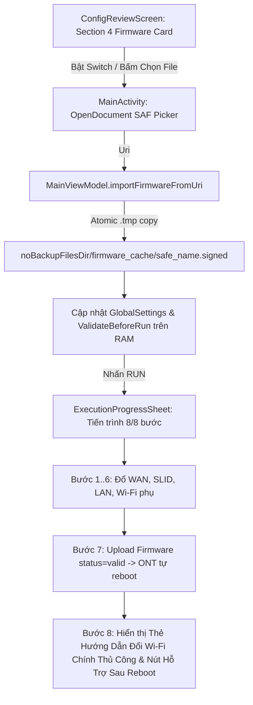

# Phase 2: Android SAF File Picker, ViewModel & Compose UI Integration

## Overview
Tích hợp bộ chọn file Firmware qua Android Storage Access Framework (`ActivityResultContracts.OpenDocument`), quản lý bộ nhớ đệm file Firmware trong `MainViewModel`, bổ sung thẻ cấu hình **"4. Cập Nhật Firmware ONT (Trước bước đổi Wi-Fi chính)"** trên `ConfigReviewScreen`, và cập nhật `ExecutionProgressSheet` để hiển thị tiến trình 8 bước cùng bảng hướng dẫn đổi Wi-Fi kết nối chính thủ công sau khi ONT khởi động lại.

## Requirements
- **Functional:**
  - Trong `OntWifiConnector.kt` và `MainViewModel.kt` (`[Red Team RT-01, RT-07]`):
    - Thêm cờ `@Volatile var suppressAutoBindAfterFirmware: Boolean = false` trên `MainViewModel` (và kiểm tra trong `performGatewayProbeOnce()` cùng `startMonitoringSystemWifi` callback): ngay khi `executeMobileSetup()` hoàn tất với `result.firmwareUpdated == true`, bật `suppressAutoBindAfterFirmware = true` để vòng lặp ngầm 1 giây **không tự động gọi `bindCurrentWifiNetworkIfConnected()` hay `probeGateway()`** vào chiếc ONT đang ghi flash/khởi động lại, giữ vững kết nối 4G/5G cho điện thoại. Cờ này chỉ tắt về `false` khi KTV chủ động bấm **"Bắt Wi-Fi ONT"** (`openWifiScanner`), bấm **"Đổi nốt Wi-Fi chính"** (`runManualConnectedWifiStep`), bấm **"Kết nối vào Wi-Fi mới"** (`joinNewlyConfiguredWifi`), hoặc chọn sang thuê bao khác (`selectSubscriber`).
    - Mở rộng `OntWifiConnector.detectConnectedBand(ssidHint: String?, configured24Ssid: String? = null, configured5Ssid: String? = null)` (`[Red Team RT-07]`): khi Android 10+ ẩn `frequency == -1`, đối chiếu thêm với `configured5Ssid` / `configured24Ssid` của thuê bao để không nhận nhầm sóng 5GHz tùy chỉnh thành 2.4GHz; đồng thời trong `runOntConfiguration()`, nếu `effectiveSsid` trùng với băng tần phụ đã cấu hình từ lần chạy trước thì truyền `alreadyConfiguredOppositeBand = true` vào `executeMobileSetup()`.
  - Trong `MainViewModel` (`android-app/app/src/main/java/vn/vnpt/ontconfig/ui/MainViewModel.kt`) (`[Red Team RT-04, RT-05, RT-06, RT-08]`):
    - Thêm `isImportingFirmware: Boolean = false` và `manualWifiError: String? = null` vào `MainUiState`.
    - Thêm `MainUiState.defaultEightStepsWithFirmware()` gồm 8 bước trực quan khi bật nâng cấp Firmware:
      1. `Bước 1/8: Kiểm tra kết nối & nhận diện ONT Gateway`
      2. `Bước 2/8: Đăng nhập & Đổi mật khẩu Admin`
      3. `Bước 3/8: Cấu hình WAN PPPoE (VLAN 11)`
      4. `Bước 4/8: Cài đặt GPON Password (SLID / Mã MEN)`
      5. `Bước 5/8: Kiểm tra & Lưu cấu hình LAN IPv4`
      6. `Bước 6/8: Cấu hình Wi-Fi băng tần phụ`
      7. `Bước 7/8: Tải lên & Cập nhật Firmware ONT (Trước bước cuối)`
      8. `Bước 8/8: Đổi Wi-Fi kết nối chính (Thực hiện thủ công sau khi ONT reboot)`
    - Khi khởi tạo `MainViewModel` (`init`), tự động kiểm tra thư mục nội bộ không bị export qua FileProvider `File(appContext.noBackupFilesDir, "firmware_cache")` (`[Red Team RT-04]`) xem có sẵn file Firmware hợp lệ đã chọn từ phiên trước không; nếu có (`isFile && OntInputValidator.isValidFirmwareExtension(name) && length() in MIN..MAX`), điền sẵn `firmwareFilePath`, `firmwareFileName`, `firmwareFileSize` vào `globalSettings` (nhưng giữ `enableFirmwareUpdate = false` mặc định khi mới mở app để an toàn tuyệt đối, và giữ nguyên trạng thái công tắc KTV đã bật xuyên suốt các thuê bao trong phiên).
    - Trong `updateGlobalSettings(newSettings: GlobalSettings)`: khi `enableFirmwareUpdate` thay đổi và `!isRunningSetup`, tự động đồng bộ `stepProgressList` giữa `defaultEightStepsWithFirmware()` và `defaultSevenSteps()` (`[Red Team RT-08]`).
    - Thêm hàm `importFirmwareFromUri(uri: Uri)` (`[Red Team RT-04]`):
      - Đặt `isImportingFirmware = true` trong `MainUiState` để khóa nút `RUN` trong lúc đang chép file.
      - Đọc tên file hiển thị (`OpenableColumns.DISPLAY_NAME`) và kích thước (`OpenableColumns.SIZE`) từ `ContentResolver`; kiểm tra sớm `OntInputValidator.isValidFirmwareExtension(displayName)` và kích thước nằm trong `64 KB .. 64 MB` trước khi copy.
      - Sao chép luồng dữ liệu có giới hạn tối đa `MAX_FIRMWARE_SIZE_BYTES` vào file tạm `File(cacheDir, "fw_upload.tmp")` trên `Dispatchers.IO`. Chỉ sau khi chép thành công và xác nhận kích thước hợp lệ mới xóa các file cũ trong `File(appContext.noBackupFilesDir, "firmware_cache")`, đổi tên/di chuyển `fw_upload.tmp` sang `File(firmwareCacheDir, safeName)` (nguyên tử, không làm mất file cũ nếu lần chọn file mới bị lỗi `[Red Team RT-04]`), rồi cập nhật `globalSettings` (`enableFirmwareUpdate = true`, `firmwareFilePath`, `firmwareFileName`, `firmwareFileSize`) và `statusMessage`.
    - Trong `runOntConfiguration()` (`[Red Team RT-05]`):
      - Khi `result.manualWifiStepPending == true`, ghi nhận `errorMessage = "Đã nạp FW (${result.firmwareFileName}), chờ đổi Wi-Fi ${result.manualWifiBandLabel} ('${result.manualWifiSsid}') thủ công sau khi ONT khởi động lại"` vào `SubscriberRecord` để báo cáo Excel xuất ra ghi chú rõ trạng thái chờ đổi Wi-Fi chính thay vì ghi `"OK"` giả tạo khi sóng chính chưa đổi mật khẩu.
    - Thêm hàm `runManualConnectedWifiStep()` trên `MainViewModel` (`[Red Team RT-06]`):
      - Tắt `suppressAutoBindAfterFirmware = false`, gọi `wifiConnector.bindCurrentWifiNetworkIfConnected()`, khởi tạo `OntMobileDriver` với `boundWifiNetwork?.socketFactory` và `probePauseMutex`, rồi gọi `driver.executeManualConnectedWifiOnly(...)`.
      - Nếu thành công: cập nhật Bước 8 sang `StepStatus.SUCCESS`, cập nhật `setupResult = currentResult.copy(manualWifiStepPending = false)`, xóa `manualWifiError = null`, và cập nhật `SubscriberRecord.errorMessage = ""` trong Room DB.
      - Nếu lỗi (ví dụ KTV bấm sớm khi ONT chưa khởi động xong 2 phút): lưu lỗi vào `manualWifiError` (không ghi đè `executionError` và không xóa `setupResult`) để KTV chỉ cần đợi thêm 30s rồi bấm lại nút đổi Wi-Fi chính, **tuyệt đối không chạy lại 8 bước nạp Firmware lần 2**.
  - Trong `MainActivity.kt` (`android-app/app/src/main/java/vn/vnpt/ontconfig/MainActivity.kt`) (`[Red Team RT-06, RT-08]`):
    - Đăng ký `firmwarePickerLauncher = rememberLauncherForActivityResult(ActivityResultContracts.OpenDocument()) { uri -> if (uri != null) viewModel.importFirmwareFromUri(uri) }`.
    - Truyền `isRunningSetup = uiState.isRunningSetup`, `isImportingFirmware = uiState.isImportingFirmware`, và `onPickFirmwareFile = { firmwarePickerLauncher.launch(arrayOf("application/octet-stream", "*/*")) }` xuống `ConfigReviewScreen`.
    - Trên `ExecutionProgressSheet`: truyền `manualWifiError = uiState.manualWifiError` và `onRunManualConnectedWifi = viewModel::runManualConnectedWifiStep`; trong `onOpenWifiScanner`, **không gọi `viewModel.dismissExecutionSheet()`** khi `uiState.setupResult?.manualWifiStepPending == true` để KTV có thể mở hộp thoại bắt lại Wi-Fi ONT sau khi ONT khởi động xong mà không bị mất bảng hoàn tất Bước 8 (`[Red Team RT-06]`).
  - Trong `ConfigReviewScreen.kt` (`android-app/app/src/main/java/vn/vnpt/ontconfig/ui/screens/ConfigReviewScreen.kt`) (`[Red Team RT-08]`):
    - Nhận thêm tham số `isRunningSetup: Boolean = false`, `isImportingFirmware: Boolean = false`, `onPickFirmwareFile: () -> Unit = {}` và hiển thị `statusMessage` khi có thông báo.
    - Bổ sung **Section 4: Cập Nhật Firmware ONT (Trước bước đổi Wi-Fi kết nối)** ngay dưới Section 3:
      - Hàng công tắc `Switch` (`enabled = !isRunningSetup && !isImportingFirmware`): `"Nâng cấp Firmware trước bước đổi Wi-Fi kết nối chính"`.
      - Hiển thị thông tin file Firmware đã chọn (tên file + dung lượng MB màu xanh khi hợp lệ, hoặc cảnh báo màu đỏ `"Chưa chọn file Firmware (.signed / .bin / .img) hợp lệ"` khi công tắc đang bật mà chưa có file).
      - Nút `OutlinedButton` (`enabled = !isRunningSetup && !isImportingFirmware`) **"Chọn file Firmware (.signed / .bin)"** gọi `onPickFirmwareFile()`.
      - Ghi chú rõ quy trình khi bật: *"Khi bật: App sẽ đổ Bước 1–6 (WAN, SLID, LAN, Wi-Fi phụ), sau đó tải lên & cập nhật Firmware ở Bước 7. Bước đổi Wi-Fi đang kết nối sẽ để thực hiện thủ công sau khi ONT khởi động lại xong (~2 phút)."*
      - Cập nhật nút `RUN`: `enabled = validation.isValid && !isRunningSetup && !isImportingFirmware`, nhãn `"RUN • ĐỔ CẤU HÌNH + UP FW"` khi bật nâng cấp Firmware.
  - Trong `ExecutionProgressSheet.kt` (`android-app/app/src/main/java/vn/vnpt/ontconfig/ui/components/ExecutionProgressSheet.kt`) (`[Red Team RT-04, RT-05, RT-06, RT-08]`):
    - Thêm `Modifier.weight(1f, fill = false)` vào `LazyColumn` để danh sách 8 bước kèm thẻ hướng dẫn Firmware và các nút hành động luôn cuộn mượt trên mọi kích thước màn hình mà không bị cắt khuất (`[Red Team RT-08]`).
    - Tính thanh tiến trình `LinearProgressIndicator` linh hoạt theo `val totalSteps = steps.firstOrNull()?.totalSteps ?: steps.size.coerceAtLeast(1)`.
    - Khi `setupResult?.firmwareUpdated == true`:
      - Hiển thị thẻ hướng dẫn nổi bật **"⚠️ Hướng dẫn sau khi nạp Firmware (${setupResult.firmwareFileName})"** gồm trạng thái ONT đang ghi flash (~2 phút), thông số Wi-Fi phụ đã cấu hình sẵn (`configuredSecondarySsid`), thông số Wi-Fi kết nối chính cần đổi thủ công (`manualWifiSsid` / `manualWifiPass`), và tài khoản Admin (`admin` / mật khẩu ẩn mặc định kèm nút mắt bật/tắt `[Red Team RT-04]`).
      - Khi `setupResult.manualWifiStepPending == true`:
        - Hiển thị hàng 2 nút thao tác sau khi ONT khởi động xong: nút **"1. Bắt lại Wi-Fi ONT"** (`onOpenWifiScanner`) và nút **"2. Đổi nốt Wi-Fi ${setupResult.manualWifiBandLabel} ('${setupResult.manualWifiSsid}')"** (`onRunManualConnectedWifi`), kèm hiển thị `manualWifiError` (nếu KTV bấm khi ONT chưa boot xong) ngay trong thẻ mà không kích hoạt nút chạy lại toàn bộ 8 bước (`[Red Team RT-06]`).
        - Nút **"Kết nối vào Wi-Fi mới để kiểm tra mạng"** (`onJoinNewWifi`) tự động trỏ tới `(setupResult.configuredSecondarySsid, setupResult.configuredSecondaryPass)` khi `manualWifiStepPending == true` và chuyển về `(setupResult.newSsid24g, setupResult.newPass24g)` sau khi đã đổi xong Wi-Fi chính (`[Red Team RT-05]`).
- **Non-functional:**
  - Khóa các nút chọn file/công tắc Firmware khi `isRunningSetup == true` hoặc `isImportingFirmware == true`.
## Architecture

## Related Code Files
- Modify: `android-app/app/src/main/java/vn/vnpt/ontconfig/core/wifi/OntWifiConnector.kt`
- Modify: `android-app/app/src/main/java/vn/vnpt/ontconfig/ui/MainViewModel.kt`
- Modify: `android-app/app/src/main/java/vn/vnpt/ontconfig/MainActivity.kt`
- Modify: `android-app/app/src/main/java/vn/vnpt/ontconfig/ui/screens/ConfigReviewScreen.kt`
- Modify: `android-app/app/src/main/java/vn/vnpt/ontconfig/ui/components/ExecutionProgressSheet.kt`
## Implementation Steps
1. Trong `MainViewModel.kt`:
   - Thêm `defaultEightStepsWithFirmware()`, `isImportingFirmware`, và `manualWifiError` vào `MainUiState`.
   - Thêm `loadCachedFirmwareOnInit()`, `suppressAutoBindAfterFirmware`, `importFirmwareFromUri(uri: Uri)`, cập nhật `updateGlobalSettings(newSettings: GlobalSettings)`, và cài đặt `runManualConnectedWifiStep()`.
   - Cập nhật `runOntConfiguration()` để chọn bộ bước 8 bước hoặc 7 bước dựa trên `settings.enableFirmwareUpdate` và lưu ghi chú chờ đổi Wi-Fi chính khi `manualWifiStepPending == true`.
2. Trong `MainActivity.kt`:
   - Thêm `firmwarePickerLauncher` (`ActivityResultContracts.OpenDocument()`) và nối callback xuống `ConfigReviewScreen` cùng `ExecutionProgressSheet`.
3. Trong `ConfigReviewScreen.kt`:
   - Thêm thẻ **Section 4: Cập Nhật Firmware ONT (Trước bước đổi Wi-Fi kết nối)** với `Switch`, hiển thị tên/dung lượng file, nút chọn file `.signed`/`.bin`, và cập nhật nhãn nút `RUN`.
4. Trong `ExecutionProgressSheet.kt`:
   - Sửa `LinearProgressIndicator` dùng `totalSteps` động (`7` hoặc `8`).
   - Hiển thị thẻ hướng dẫn chi tiết để KTV cấu hình Wi-Fi kết nối chính thủ công sau khi ONT cập nhật Firmware xong, kèm nút hỗ trợ đẩy cấu hình Wi-Fi chính sau khi ONT khởi động lại.

## Todo
- [x] Bổ sung quản lý chọn/lưu đệm file Firmware và hàm `runManualConnectedWifiStep()` trong `MainViewModel.kt`
- [x] Kết nối `firmwarePickerLauncher` trong `MainActivity.kt`
- [x] Thiết kế Section 4 (Thẻ tùy chọn Cập nhật Firmware) trên `ConfigReviewScreen.kt`
- [x] Cập nhật `ExecutionProgressSheet.kt` hỗ trợ 8 bước và thẻ hướng dẫn đổi Wi-Fi chính thủ công sau khi update Firmware

## Success Criteria
- [x] KTV có thể chọn file `.signed` / `.bin` từ bộ nhớ điện thoại qua SAF, hiển thị đúng tên file và dung lượng MB trên `ConfigReviewScreen`.
- [x] Khi bật công tắc Cập nhật Firmware mà chưa chọn file, nút `RUN` bị khóa kèm thông báo nhắc chọn file rõ ràng.
- [x] `ExecutionProgressSheet` hiển thị đúng 8/8 bước khi bật Firmware (hoặc 7/7 bước khi tắt) và hiển thị đầy đủ hướng dẫn đổi Wi-Fi kết nối chính thủ công sau khi nạp Firmware thành công.

## Risk Assessment
- **Rủi ro (Android SAF `Uri` mất quyền đọc khi chuyển màn hình hoặc chọn file từ ứng dụng bên thứ 3 như Zalo/Downloads):**
  - *Tín hiệu nhận biết:* `SecurityException` hoặc không lấy được `File` trực tiếp từ `content://` URI khi bấm `RUN`.
  - *Giải pháp:* Sao chép nguyên tử qua file tạm `.tmp` từ `contentResolver.openInputStream(uri)` vào `File(appContext.noBackupFilesDir, "firmware_cache/$safeName")` ngay tại thời điểm chọn file (`importFirmwareFromUri`), sau đó `OntMobileDriver` chỉ làm việc với `File` nội bộ ổn định (`[Red Team RT-04]`).
