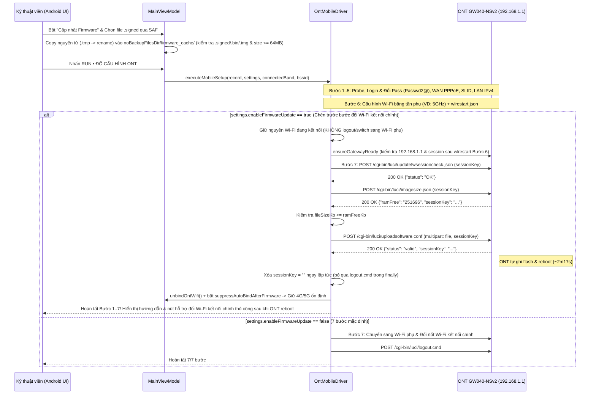

# Kế Hoạch: Bổ Sung Tính Năng Upload & Cập Nhật Firmware ONT Trước Bước Đổi Wi-Fi Kết Nối Chính (`android-app/`)

## Overview
Dựa trên luồng nâng cấp Firmware (`Update Software`) đã chuẩn hóa trên bản PC (`app/core/ont_driver.py:359-451`) của thiết bị **VNPT iGate GW040-NSv2**, giao thức nạp Firmware qua LuCI CGI gồm 3 bước tuần tự:
1. `POST /cgi-bin/luci/updatefwsessioncheck.json` (`sessionKey=<token>`, `Referer: https://192.168.1.1/update_software.html`) → `{"status": "OK"}`
2. `POST /cgi-bin/luci/imagesize.json` (`sessionKey=<token>`) → `{"ramFree": "251696", "sessionKey": "<token>"}` (kiểm tra dung lượng file KB $\le$ `ramFree` KB)
3. `POST /cgi-bin/luci/uploadsoftware.conf` (`multipart/form-data` gồm `file` nhị phân `application/octet-stream` và `sessionKey`) → `{"status": "valid", "sessionKey": "<token>"}`

Khác với bản PC kết nối qua cáp LAN (có thể đổi cả 2 băng tần Wi-Fi rồi mới nạp Firmware ở cuối), bản **Android Native (`android-app/`)** kết nối không dây trực tiếp vào sóng Wi-Fi đang phát của ONT (`connectedBand` — thường là `2.4GHz`). Do đó, khi bật tùy chọn **Cập nhật Firmware**:
- **Bước 1..6** vẫn thực thi tự động trên kết nối Wi-Fi hiện tại: Probe Gateway $\rightarrow$ Đăng nhập & Đổi mật khẩu Admin (`Passwd2@`) $\rightarrow$ WAN PPPoE (VLAN 11) $\rightarrow$ GPON SLID $\rightarrow$ LAN IPv4 $\rightarrow$ Cấu hình **Wi-Fi băng tần phụ** (ví dụ `5GHz` khi máy đang bắt sóng `2.4GHz`).
- **Không chuyển sóng ở cuối Bước 6**, mà giữ nguyên kết nối ổn định trên băng tần hiện tại (kèm kiểm tra kết quả `ensureGatewayReadyBeforeStep7` có khôi phục `OntUserExistError` nếu `wlrestart.json` của băng tần phụ làm gián đoạn nhẹ `[Red Team RT-02]`) để thực hiện **Bước 7 (trước bước cuối): Upload & Cập nhật Firmware ONT** (`updatefwsessioncheck.json` $\rightarrow$ `imagesize.json` $\rightarrow$ `uploadsoftware.conf`).
- Ngay khi `uploadsoftware.conf` trả về `{"status": "valid"}` (hoặc ngắt socket sau khi đã flush đủ 100% dữ liệu file `[Red Team RT-03]`), ONT lập tức ghi flash và tự khởi động lại (~2 phút 17 giây). Driver xóa ngay `sessionKey = ""` (tránh gửi `logout.cmd` thừa vào ONT đang flash), giải phóng `unbindOntWifi()` kèm cờ `suppressAutoBindAfterFirmware` chặn vòng lặp `performGatewayProbeOnce()` tự động gắn lại Wi-Fi ONT làm mất 4G/5G (`[Red Team RT-01]`), và chuyển **Bước cuối (Bước đổi cấu hình Wi-Fi kết nối chính)** sang trạng thái **thực hiện thủ công sau khi ONT cập nhật Firmware xong** (kèm ghi chú trạng thái rõ ràng khi xuất Excel `[Red Team RT-05]`, bảng hướng dẫn thông số trực quan và nút hỗ trợ đẩy nhanh cấu hình Wi-Fi chính đầy đủ chu trình Probe + Login + Apply sau khi ONT khởi động lại `[Red Team RT-06]`).
---

## Scope Challenge Summary
- **Existing code:** `app/core/ont_driver.py` (`update_firmware`, `execute_full_setup`), `android-app/.../OntMobileDriver.kt` (`executeMobileSetup`), `GlobalSettings.kt`, `OntInputValidator.kt`, `MainViewModel.kt`, `ConfigReviewScreen.kt`, `ExecutionProgressSheet.kt`, `MainActivity.kt`.
- **Requested scope:** Bổ sung tính năng chọn/upload file Firmware và cập nhật Firmware cho ONT trên bản `android-app` ở **trước bước cuối (bước đổi cấu hình Wi-Fi kết nối chính)**; bước cấu hình Wi-Fi kết nối chính để sau khi update firmware xong sẽ làm thủ công.
- **Complexity:** Chỉnh sửa 7 file mã nguồn Kotlin trong `android-app/`, 2 file unit test (`OntMobileDriverTest.kt`, `ExcelAndValidatorTest.kt`) và tài liệu hướng dẫn; không phát sinh thêm thư viện phụ thuộc ngoài.
- **Selected mode:** `HOLD SCOPE` (`fast` mode — đặc tả giao thức LuCI CGI đã có đầy đủ từ `app/core/ont_driver.py`).

---

## Goals

| # | Goal | Priority |
|---|------|----------|
| 1 | Mở rộng `GlobalSettings`, `OntInputValidator` và `OntMobileDriver` để hỗ trợ `updateFirmware()` qua `multipart/form-data` ở ngay trước bước đổi Wi-Fi kết nối chính, xóa `sessionKey` ngay khi `status == "valid"` và chuyển bước đổi Wi-Fi kết nối chính sang thủ công | P1 |
| 2 | Bổ sung giao diện chọn file Firmware qua Android SAF (`OpenDocument`), lưu đệm (streaming file cache) trong `MainViewModel`, hiển thị thẻ tùy chọn Firmware trên `ConfigReviewScreen` và bảng hướng dẫn hoàn tất Wi-Fi chính thủ công (kèm nút hỗ trợ đổi nhanh sau khi ONT reboot) trên `ExecutionProgressSheet` | P1 |
| 3 | Bổ sung bộ Unit Tests (`OntMobileDriverTest.kt`, `ExcelAndValidatorTest.kt`) kiểm thử toàn diện luồng upload Firmware nhị phân qua `MockWebServer`, kiểm tra RAM trống, xử lý lỗi và cập nhật tài liệu | P1 |

---

## Architecture & Sequence Flow

---

## Phases

| # | Phase | Status |
|---|-------|--------|
| 1 | [Phase 1: Core Driver, Models & Validation Firmware Update Flow](./phase-01-start.md) | Completed |
| 2 | [Phase 2: Android SAF File Picker, ViewModel & Compose UI Integration](./phase-02-android-ui-and-viewmodel.md) | Completed |
| 3 | [Phase 3: MockWebServer Unit Tests & Documentation](./phase-03-unit-tests-and-docs.md) | Completed |

---

## Cross-Plan Dependencies

| Relationship | Plan | Status |
|-------------|------|--------|
| None | — | — |

---

## Success Criteria
- [x] Khi **tắt** tùy chọn Cập nhật Firmware (mặc định `enableFirmwareUpdate = false`): ứng dụng Android giữ nguyên 100% quy trình 7/7 bước hiện tại (bao gồm tự động chuyển sang Wi-Fi phụ và đổi Wi-Fi kết nối chính ở Bước 7).
- [x] Khi **bật** tùy chọn Cập nhật Firmware (`enableFirmwareUpdate = true`): kiểm tra định dạng (`.signed`, `.bin`, `.img`) và dung lượng file hợp lệ ($64\text{ KB} \le \text{size} \le 64\text{ MB}$) qua biến bộ nhớ `firmwareFileSize` (không gọi `File.isFile` trên luồng UI `[Red Team RT-04]`); thực hiện tuần tự Bước 1..6 (lưu xong WAN, SLID, LAN, Wi-Fi băng tần phụ), kiểm tra `ensureGatewayReadyBeforeStep7` (có xử lý `OntUserExistError` `[Red Team RT-02]`), sau đó thực hiện **Bước 7: Upload & Cập nhật Firmware** (`updatefwsessioncheck.json` $\rightarrow$ `imagesize.json` $\rightarrow$ `uploadsoftware.conf`) ngay trước bước đổi cấu hình Wi-Fi kết nối chính.
- [x] Ngay khi `uploadsoftware.conf` trả về `{"status": "valid"}`, xóa ngay `sessionKey = ""` trước khi return khỏi `updateFirmware()` để khối `finally` không gửi `logout.cmd` vào ONT đang ghi flash, đồng thời giải phóng `unbindOntWifi()` và bật `suppressAutoBindAfterFirmware = true` để `performGatewayProbeOnce()` không tự gắn lại Wi-Fi ONT làm đứt 4G/5G (`[Red Team RT-01]`).
- [x] Bước cuối (đổi cấu hình Wi-Fi kết nối chính) được chuyển sang hướng dẫn thực hiện thủ công sau khi ONT khởi động lại xong (lưu ghi chú chờ đổi Wi-Fi chính vào `SubscriberRecord.errorMessage` khi xuất báo cáo Excel `[Red Team RT-05]`, hướng nút `onJoinNewWifi` vào Wi-Fi phụ đã cấu hình sẵn, và cung cấp nút tiện ích **"Đổi nốt Wi-Fi chính sau khi ONT đã khởi động xong"** thực hiện đầy đủ `bindCurrentWifiNetworkIfConnected` $\rightarrow$ `probeGateway` $\rightarrow$ `loginAndChangePassword` $\rightarrow$ `configureWifiBand(isConnectedBandFinalStep=true)` mà không chạy lại 8 bước nạp Firmware `[Red Team RT-06]`).
- [x] Toàn bộ Unit Tests trong `android-app` (`./gradlew testDebugUnitTest`) chạy xanh 100%.

---

## Red Team Review

### Session — 2026-10-28
**Findings:** 8 (8 accepted, 0 rejected)
**Severity breakdown:** 5 Critical, 2 High, 1 Medium

| # | Finding | Severity | Disposition | Applied To |
|---|---------|----------|-------------|------------|
| RT-01 | Vòng lặp ngầm `performGatewayProbeOnce()` (`MainViewModel.kt:115-171`) và `passiveWifiMonitorCallback` (`OntWifiConnector.kt:75-91`) tự động gọi `bindCurrentWifiNetworkIfConnected()` ngay sau khi Bước 7/8 kết thúc (trong $\le 1\text{s}$), làm mất 4G/5G và bắn HTTP probe liên tục vào ONT đang ghi flash | Critical | Accept | Phase 2, Phase 3 |
| RT-02 | `ensureGatewayReadyBeforeStep7()` (`OntMobileDriver.kt:521-583`) chưa được kiểm tra giá trị trả về `Boolean`, nuốt ngoại lệ đăng nhập lại (`catch (_: Exception) {}`) và thiếu nhánh giải phóng `sessionKey` cũ khi gặp `OntUserExistError` sau khi Bước 6 chạy `wlrestart.json` mà không `logout()` | Critical | Accept | Phase 1, Phase 3 |
| RT-03 | `updateFirmware()` cần bọc `IOException` $\rightarrow$ `OntNetworkError` ở cả `updatefwsessioncheck.json` và `imagesize.json`, xoay vòng `sessionKey` ở cả 3 bước, giữ `connectTimeout = timeoutMs` (5s) thay vì 120s trong `buildUploadHttpClient`, bảo toàn kiểu ngoại lệ con (`OntNetworkError`/`OntValidationError`) khi tiền tố hóa lỗi Bước 7, và xóa `sessionKey = ""` nếu socket ngắt sau khi đã flush đủ 100% dữ liệu file multipart | Critical | Accept | Phase 1, Phase 3 |
| RT-04 | Lưu đệm file Firmware qua SAF cần đặt trong `noBackupFilesDir/firmware_cache` (ngoài `file_paths.xml`), copy nguyên tử qua file `.tmp` kèm giới hạn đuôi file (`.signed`, `.bin`, `.img`) và dung lượng ($64\text{ KB} \le \text{size} \le 64\text{ MB}$), kiểm tra `settings.firmwareFileSize` trong bộ nhớ ở `validateBeforeRun` (tránh gọi `File.isFile` trên UI thread), URL-encode `sessionKey` và che mật khẩu Admin mặc định trên `ExecutionProgressSheet` | Critical | Accept | Phase 1, Phase 2, Phase 3 |
| RT-05 | Khi `manualWifiStepPending == true`, cần giữ Bước 8 ở trạng thái chờ hoàn tất thủ công, ghi chú rõ vào `SubscriberRecord.errorMessage` để báo cáo Excel không xuất `"OK"` giả tạo khi băng tần chính vẫn là sóng Open, và trỏ nút `onJoinNewWifi` vào `configuredSecondarySsid` thay vì `newSsid24g` chưa được đổi | Critical | Accept | Phase 1, Phase 2, Phase 3 |
| RT-06 | Hàm `executeManualConnectedWifiOnly()` và `runManualConnectedWifiStep()` phải thực hiện đầy đủ `probePauseMutex`, `bindCurrentWifiNetworkIfConnected()`, `probeGateway()` (RT-10), `loginAndChangePassword()`, `configureWifiBand(isConnectedBandFinalStep=true)`; đồng thời không đóng `ExecutionProgressSheet` khi mở hộp thoại quét Wi-Fi và tách `manualWifiError` riêng để nút Thử lại không chạy lại 8 bước nạp Firmware lần 2 | High | Accept | Phase 1, Phase 2, Phase 3 |
| RT-07 | Khi bấm `Chạy Lại (RUN)` sau lỗi Bước 7 mà điện thoại đã tự chuyển sang sóng Wi-Fi phụ vừa đổi ở Bước 6 (`effectiveWifi5Ssid` / `effectiveWifi24Ssid`), cần nhận diện đúng băng tần theo SSID thuê bao khi Android 10+ ẩn `frequency == -1` và đánh dấu cả 2 băng tần đã cấu hình xong sau Bước 6 của lần chạy lại | High | Accept | Phase 1, Phase 2, Phase 3 |
| RT-08 | `ExecutionProgressSheet.kt:105` cần thêm `Modifier.weight(1f, fill = false)` cho `LazyColumn` để không đẩy thẻ hướng dẫn Firmware và các nút bấm tràn khỏi màn hình; `OntMobileDriver.kt` cần dùng `$totalSteps` động cho tiêu đề Bước 1..6; `ConfigReviewScreen` cần nhận `isRunningSetup`, `onPickFirmwareFile` và hiển thị `statusMessage` | Medium | Accept | Phase 1, Phase 2 |

### Whole-Plan Consistency Sweep
- Files reread: `plan.md`, `phase-01-start.md`, `phase-02-android-ui-and-viewmodel.md`, `phase-03-unit-tests-and-docs.md`
- Decision deltas checked: 8 (`RT-01`..`RT-08`)
- Reconciled stale references: 8
- Unresolved contradictions: 0

<!-- slug: android-firmware-update-step -->