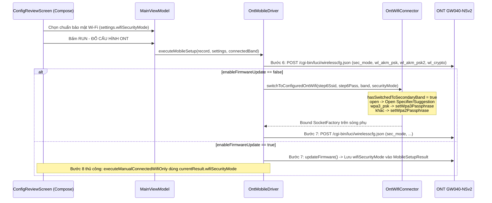

# Phase 2: Android Mobile Wi-Fi Security Mode, Connector & Compose UI

## Overview
Bổ sung chức năng chọn loại bảo mật Wi-Fi trên ứng dụng Android Native (`android-app/`), bao gồm tầng model `GlobalSettings` (`WifiSecurityMode`), `SubscriberRecord`, kiểm tra hợp lệ `OntInputValidator`, giao thức `OntMobileDriver` (cả luồng tự động 7/8 bước và bước đổi Wi-Fi kết nối chính thủ công sau nạp Firmware), `OntWifiConnector` (kết nối sóng phụ tương thích `open`, `wpa2`, `wpa3`), và giao diện Jetpack Compose `ConfigReviewScreen` + `ExecutionProgressSheet`.

## Requirements
- **Functional:**
  - Định nghĩa enum `WifiSecurityMode` trong `GlobalSettings.kt` với 6 chế độ chuẩn (`WPA2_WPA3_PSK`, `WPA2_PSK`, `WPA_WPA2_PSK`, `WPA3_PSK`, `WPA_PSK`, `OPEN`), chứa `formValue` (`sec_mode`), `displayLabel`, `shortLabel`, `akmPsk`, `akmPsk2`, `crypto`, `requiresPassword`.
  - Thêm `val wifiSecurityMode: String = WifiSecurityMode.WPA2_WPA3_PSK.formValue` vào `GlobalSettings`.
  - **[Red Team RT-04, RT-06]** Cập nhật `SubscriberRecord.kt` & `OntInputValidator.kt`:
    - Trong `SubscriberRecord.kt`: trim `ssid24g`, `pass24g`, `ssid5g`, `pass5g` trong `effectiveWifi24Ssid`, `effectiveWifi24Pass`, `effectiveWifi5Ssid`, `effectiveWifi5Pass` (đồng bộ với `SubscriberRecord.swift`) và thêm helper `effectiveWifi24PassForMode(secMode: String)` / `effectiveWifi5PassForMode(secMode: String)` trả về `""` khi `secMode == "open"` và trường gốc trống (`[Red Team RT-05, RT-06]`).
    - Trong `OntInputValidator.sanitizeInputMetacharacters` & `validateOnImport`: chặn thêm ký tự điều khiển ASCII (`ch.code < 0x20 || ch.code == 0x7F`) để ngăn chặn `\u007f` delimiter injection (`[Red Team RT-04]`).
    - Trong `OntInputValidator.validateBeforeRun(record, settings)`:
      - Kiểm tra `val secMode = WifiSecurityMode.fromFormValue(settings.wifiSecurityMode)`; nếu `null`, thêm lỗi `"Chế độ bảo mật Wi-Fi '${settings.wifiSecurityMode}' không hợp lệ"`.
      - Kiểm tra `ssid24` và `ssid5` chỉ chứa ký tự ASCII in được (`0x20..0x7E`) và không chứa toàn dấu cách.
      - Khi `secMode?.requiresPassword != false`: kiểm tra `pass24.length in 8..63` và `pass5.length in 8..63`, chỉ chứa ASCII in được (`0x20..0x7E`), không chứa toàn dấu cách.
      - Khi `secMode == WifiSecurityMode.OPEN`: không bắt buộc mật khẩu 8..63 ký tự (nhưng nếu có nhập thì phải là ASCII in được và không chứa shell metacharacters), đồng thời đặt `canPrependZero24g = false` và `canPrependZero5g = false` (`[Red Team RT-06]`).
  - **[Red Team RT-01, RT-05]** Cập nhật `OntMobileDriver.kt`:
    - Bổ sung `val wifiSecurityMode: String = WifiSecurityMode.WPA2_WPA3_PSK.formValue` vào `MobileSetupResult` để lưu giữ chính xác chế độ bảo mật đã chạy ở Bước 6 cho Bước 8 thủ công sau khi ONT reboot cũng như hiển thị trên `ExecutionProgressSheet` (`[Red Team RT-05]`).
    - Mở rộng `configureWifiBand(unit, ssid, password, secMode = WifiSecurityMode.WPA2_WPA3_PSK.formValue, isConnectedBandFinalStep = false)`:
      - Kiểm tra `val mode = WifiSecurityMode.fromFormValue(secMode) ?: throw OntValidationError(...)`.
      - Nếu `mode.requiresPassword`, kiểm tra `password.trim().length in 8..63`.
      - Tạo payload `wirelesscfg.json` với `sec_mode=${mode.formValue}`, `wl_akm_psk=${mode.akmPsk}`, `wl_akm_psk2=${mode.akmPsk2}`, `wl_crypto=${mode.crypto}`.
      - Kiểm tra phản hồi JSON từ `wirelesscfg.json`: nếu `cfgJson.optString("status") == "conflict_mesh"`, ném `OntDriverException("ONT đang chạy Mesh nên không cho phép đổi chế độ bảo mật Wi-Fi sang Open (chỉ hỗ trợ WPA2-PSK hoặc WPA-PSK/WPA2-PSK).")`; nếu `status` khác rỗng và `!= "OK"`, ném `OntDriverException`.
    - Trong vòng lặp retry Bước 7 (`for (step7Attempt in 1..3)` tại `OntMobileDriver.kt:1265`): nếu bắt được `OntValidationError` hoặc `OntDriverException` không phải `OntNetworkError` (ví dụ `conflict_mesh`), **ném trả ngay lập tức (`throw e`)** mà không chạy `ensureGatewayReadyBeforeStep7` hay thử lại 3 lần (`[Red Team RT-01]`).
    - Trong `executeMobileSetup()` và `executeManualConnectedWifiOnly()`:
      - Khi `settings.wifiSecurityMode == "open"`, gán mật khẩu kết quả trong `MobileSetupResult` là `""` (không gán `"1234567890"` giả tạo) và hiển thị `"Không mật khẩu (Open)"` trong thông báo Bước 8 (`[Red Team RT-05]`).
      - Trong `executeManualConnectedWifiOnly()`: nhận thêm `targetSecMode: String = settings.wifiSecurityMode`, kiểm tra `WifiSecurityMode.fromFormValue(targetSecMode)` và độ dài mật khẩu **trước khi** `probePauseMutex?.lock()` (`[Red Team RT-05]`).
  - **[Red Team RT-03]** Cập nhật `OntWifiConnector.kt` & `MainViewModel.kt`:
    - Trong `OntWifiConnector.kt`:
      - Hỗ trợ `securityMode: String = WifiSecurityMode.WPA2_WPA3_PSK.formValue` trên cả `connectToOntWifi`, `switchToConfiguredOntWifi` và `promptJoinCustomerWifi`.
      - Trong `switchToConfiguredOntWifi`: sửa điều kiện tạo `WifiNetworkSuggestion` thành `if (Build.VERSION.SDK_INT >= Build.VERSION_CODES.Q && ssid.isNotBlank() && (securityMode == "open" || passphrase.isNotBlank()))` để mạng Open cũng được đăng ký suggestion (`[Red Team RT-03]`).
      - Với `securityMode == "open"`: không gọi `setWpa2Passphrase` / `setWpa3Passphrase`.
      - Với `securityMode == "wpa3_psk"`: kiểm tra `wifiManager.isWpa3SaeSupported` trên Android Q+; gọi `setWpa3Passphrase(passphrase)` khi phần cứng hỗ trợ (và báo lỗi/cảnh báo rõ nếu thiết bị không hỗ trợ SAE).
    - Trong `MainViewModel.kt`:
      - Thay thế việc dùng `activeTargetPass != null` làm cờ kiểm tra đã chuyển sóng phụ bằng biến boolean tường minh `var hasSwitchedToSecondaryBand = false` (`[Red Team RT-03]`).
      - Truyền `securityMode = settings.wifiSecurityMode` vào **cả 2 điểm gọi** `wifiConnector.switchToConfiguredOntWifi` (trong `onRebindWifiNetwork` và trong `onSwitchToConfiguredWifi`) cũng như `promptJoinCustomerWifi` (`[Red Team RT-03]`).
      - Trong `runManualConnectedWifiStep()`: truyền `targetSecMode = currentResult.wifiSecurityMode` vào `driver.executeManualConnectedWifiOnly(...)` (`[Red Team RT-05]`).
  - **[Red Team RT-05, RT-06]** Cập nhật `ConfigReviewScreen.kt` & `ExecutionProgressSheet.kt`:
    - Trong **Mục 3 (`3. Tham Số Wi-Fi 2.4G & 5G`)** trên `ConfigReviewScreen.kt`: thêm bộ chọn (`ExposedDropdownMenuBox`, khóa khi `isRunningSetup || isImportingFirmware`) **"Chuẩn bảo mật Wi-Fi (2.4G & 5G)"** với 6 chế độ bảo mật.
    - Tính `isError` của 2 ô mật khẩu Wi-Fi theo `(requiresPassword && effectivePass.length !in 8..63) || rawPass.any { it in OntInputValidator.UNSAFE_SHELL_METACHARS }` (`[Red Team RT-06]`).
    - Trên `ExecutionProgressSheet.kt`: đọc `setupResult.wifiSecurityMode` để hiển thị tên chuẩn bảo mật Wi-Fi, và khi `wifiSecurityMode == "open"` hiển thị `"Không mật khẩu (Open)"` thay vì `(Pass: 1234567890)` (`[Red Team RT-05]`).

## Architecture

## Related Code Files
- Modify: `android-app/app/src/main/java/vn/vnpt/ontconfig/data/model/GlobalSettings.kt`
- Modify: `android-app/app/src/main/java/vn/vnpt/ontconfig/data/model/SubscriberRecord.kt`
- Modify: `android-app/app/src/main/java/vn/vnpt/ontconfig/core/validation/OntInputValidator.kt`
- Modify: `android-app/app/src/main/java/vn/vnpt/ontconfig/core/driver/OntMobileDriver.kt`
- Modify: `android-app/app/src/main/java/vn/vnpt/ontconfig/core/wifi/OntWifiConnector.kt`
- Modify: `android-app/app/src/main/java/vn/vnpt/ontconfig/ui/MainViewModel.kt`
- Modify: `android-app/app/src/main/java/vn/vnpt/ontconfig/ui/screens/ConfigReviewScreen.kt`
- Modify: `android-app/app/src/main/java/vn/vnpt/ontconfig/ui/components/ExecutionProgressSheet.kt`
- Modify: `android-app/app/src/test/java/vn/vnpt/ontconfig/OntMobileDriverTest.kt`
- Modify: `android-app/app/src/test/java/vn/vnpt/ontconfig/ExcelAndValidatorTest.kt`

## Implementation Steps
1. **`GlobalSettings.kt` & `SubscriberRecord.kt`**:
   - Thêm enum `WifiSecurityMode(val formValue: String, val displayLabel: String, val shortLabel: String, val akmPsk: String, val akmPsk2: String, val crypto: String, val requiresPassword: Boolean)` với 6 giá trị chuẩn và `companion object { fun fromFormValue(value: String): WifiSecurityMode? }`.
   - Thêm `val wifiSecurityMode: String = WifiSecurityMode.WPA2_WPA3_PSK.formValue` vào `GlobalSettings`.
   - Trong `SubscriberRecord.kt`: trim `pass24g` / `pass5g` trong `effectiveWifi24Pass` / `effectiveWifi5Pass` và thêm `effectiveWifi24Pass(secMode: String)` / `effectiveWifi5Pass(secMode: String)` trả về `""` khi `secMode == "open"`.
2. **`OntInputValidator.kt`**:
   - Chặn ký tự điều khiển (`ch.code < 0x20 || ch.code == 0x7F`) trong `sanitizeInputMetacharacters` và `validateOnImport`.
   - Trong `validateBeforeRun(record, settings)`: kiểm tra `WifiSecurityMode.fromFormValue(settings.wifiSecurityMode)`, kiểm tra ASCII in được (`0x20..0x7E`) và không toàn dấu cách, chỉ kiểm tra `8..63` ký tự và `canPrependZero` khi `secMode.requiresPassword == true`.
3. **`OntMobileDriver.kt`**:
   - Thêm `val wifiSecurityMode: String = WifiSecurityMode.WPA2_WPA3_PSK.formValue` vào `MobileSetupResult`.
   - Cập nhật `configureWifiBand()` nhận `secMode`, kiểm tra `WifiSecurityMode.fromFormValue(secMode)`, kiểm tra `status == "conflict_mesh"` và `status == "OK"`.
   - Trong vòng lặp Bước 7: rethrow ngay `OntValidationError` và `OntDriverException` không phải `OntNetworkError`.
   - Cập nhật `executeMobileSetup()` và `executeManualConnectedWifiOnly()` truyền `secMode` và lưu `wifiSecurityMode` vào `MobileSetupResult`.
4. **`OntWifiConnector.kt` & `MainViewModel.kt`**:
   - Bổ sung tham số `securityMode` vào `connectToOntWifi()`, `switchToConfiguredOntWifi()` và `promptJoinCustomerWifi()`.
   - Trong `MainViewModel.kt`: dùng `var hasSwitchedToSecondaryBand = false` trong `onRebindWifiNetwork`, truyền `settings.wifiSecurityMode` vào cả 2 điểm gọi `switchToConfiguredOntWifi`, và truyền `currentResult.wifiSecurityMode` vào `executeManualConnectedWifiOnly`.
5. **`ConfigReviewScreen.kt` & `ExecutionProgressSheet.kt`**:
   - Thêm `ExposedDropdownMenuBox` chọn **"Chuẩn bảo mật Wi-Fi (2.4G & 5G)"** trong Mục 3 của `ConfigReviewScreen.kt`.
   - Cập nhật `ExecutionProgressSheet.kt` hiển thị chuẩn bảo mật từ `setupResult.wifiSecurityMode` và hiển thị `"Không mật khẩu (Open)"` khi `open`.
6. **Unit Tests (`OntMobileDriverTest.kt` & `ExcelAndValidatorTest.kt`)**:
   - Bổ sung bài test kiểm tra payload `wirelesscfg.json` cho cả 6 chế độ bảo mật, kiểm tra `conflict_mesh` không bị retry 3 lần ở Bước 7, kiểm tra `MobileSetupResult.wifiSecurityMode` ở Bước 8 thủ công, và `validateBeforeRun` khi chọn `open` vs PSK.

## Todo
- [ ] Thêm `WifiSecurityMode` vào `GlobalSettings.kt` và cập nhật `SubscriberRecord.kt`
- [ ] Cập nhật `OntInputValidator.kt` hỗ trợ kiểm tra theo `wifiSecurityMode` và chặn ký tự điều khiển `\u007f`
- [ ] Cập nhật `OntMobileDriver.kt` (`MobileSetupResult`, `configureWifiBand`, `executeMobileSetup`, `executeManualConnectedWifiOnly`)
- [ ] Cập nhật `OntWifiConnector.kt` và `MainViewModel.kt` hỗ trợ `securityMode` ở cả `onSwitchToConfiguredWifi` và `onRebindWifiNetwork`
- [ ] Thêm bộ chọn chuẩn bảo mật Wi-Fi trên `ConfigReviewScreen.kt` và hiển thị trên `ExecutionProgressSheet.kt`
- [ ] Bổ sung Unit Tests trong `OntMobileDriverTest.kt` và `ExcelAndValidatorTest.kt`

## Success Criteria
- [ ] `./gradlew testDebugUnitTest` trong `android-app/` chạy PASS 100%.
- [ ] Payload `wirelesscfg.json` trên Android khớp tuyệt đối với đặc tả trong `ont-040NSv2-setup.jsonl` cho cả 6 chế độ bảo mật.

## Risk Assessment
- **Risk:** Khi KTV chọn chế độ `open` hoặc `wpa3_psk`, ở Bước 7 (khi không bật nạp Firmware) điện thoại Android tự chuyển sang sóng Wi-Fi phụ vừa đổi ở Bước 6 hoặc gọi `onRebindWifiNetwork`; nếu `OntWifiConnector` vẫn gọi cứng `setWpa2Passphrase(passphrase)`, Android sẽ không bắt được sóng Open hoặc sóng thuần WPA3-SAE.
  - **Signal:** `switchToConfiguredOntWifi` timeout sau 25s khi `wifiSecurityMode` là `open` hoặc `wpa3_psk`.
  - **Mitigation:** Truyền `settings.wifiSecurityMode` vào cả 2 điểm gọi `switchToConfiguredOntWifi` (trong `onSwitchToConfiguredWifi` và `onRebindWifiNetwork` với cờ `hasSwitchedToSecondaryBand`), bỏ qua passphrase khi `open`, dùng `setWpa3Passphrase` khi `wpa3_psk`, và dùng `setWpa2Passphrase` cho các chế độ còn lại (`[Red Team RT-03]`).
