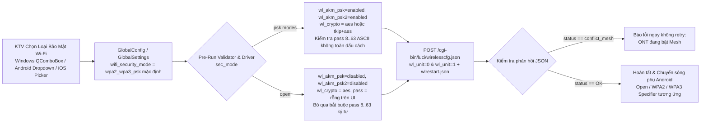

# Kế Hoạch: Bổ Sung Chức Năng Chọn Loại Bảo Mật Wi-Fi (Security Mode) Khi Đổ Cấu Hình ONT (Windows, Android & iOS)

## Overview
Từ kết quả phân tích file log thực tế `ont-040NSv2-setup.jsonl` (`seq: 176` — `wireless.html`, `seq: 181` — `wireless.js`, `seq: 189` — `lang/en/wireless.json`, `seq: 214` & `226` — `POST /cgi-bin/luci/wirelesscfg.json`), thiết bị **VNPT iGate GW040-NSv2** hỗ trợ 6 chế độ bảo mật Wi-Fi thông qua tham số `sec_mode` kèm theo tổ hợp cờ `wl_akm_psk`, `wl_akm_psk2` và kiểu mã hóa `wl_crypto`:

| Giá trị `sec_mode` | Nhãn hiển thị trên UI | Giá trị NVRAM (`nvramWlAkm`) | `wl_akm_psk` & `wl_akm_psk2` | `wl_crypto` | Ghi chú kỹ thuật từ `wireless.js` |
| :--- | :--- | :--- | :--- | :--- | :--- |
| `wpa2_wpa3_psk` | **WPA2-PSK / WPA3-PSK (Mặc định)** | `psk2 psk3` | `enabled` | `aes` | Mặc định hiện tại; khóa cứng `wl_crypto=aes` |
| `wpa2_psk` | **WPA2-PSK (Tương thích rộng / Mesh)** | `psk2` | `enabled` | `aes` | Tương thích thiết bị đời cũ & cho phép chạy Mesh 5GHz |
| `wpa_wpa2_psk` | **WPA-PSK / WPA2-PSK (Thiết bị cũ / Mesh)** | `psk psk2` | `enabled` | `tkip+aes` | Tương thích thiết bị rất cũ & cho phép chạy Mesh 5GHz |
| `wpa3_psk` | **WPA3-PSK** | `psk3` | `enabled` | `aes` | Bắt buộc `wl_crypto=aes`; trên Android 10+ dùng `setWpa3Passphrase` |
| `wpa_psk` | **WPA-PSK** | `psk` | `enabled` | `tkip+aes` | Chuẩn WPA đời đầu |
| `open` | **Open (Không mật khẩu)** | `open` | `disabled` | `aes` | Không yêu cầu mật khẩu 8..63 ký tự; bị từ chối nếu ONT đang bật Mesh (`conflict_mesh`) |

Hiện tại, cả 3 nền tảng (`app/core/ont_driver.py:316`, `OntMobileDriver.kt:496`, `OntMobileDriver.swift:534`) đang cố định `sec_mode=wpa2_wpa3_psk`. Kế hoạch này bổ sung chức năng cho phép kỹ thuật viên (KTV) lựa chọn loại bảo mật Wi-Fi để đổ xuống ONT (áp dụng đồng bộ cho cả băng tần 2.4GHz và 5GHz) trên cả **bản Desktop Windows (`app/`)** và **bản Di động (`android-app/` & `ios-app/`)**:
- **Bản Desktop Windows (`app/` & `tests/`):** Bổ sung `wifi_security_mode` vào `GlobalConfig`, thêm `QComboBox` chọn chuẩn bảo mật trên `MainWindow`, kiểm tra độ dài mật khẩu Wi-Fi `8..63` ký tự ASCII in được (không toàn dấu cách) ở ngay trước Bước 1 khi `sec_mode != "open"` (`[Red Team RT-02]`), percent-encode an toàn các tham số `wl_ssid`, `wl_wpa_psk`, `sec_mode`, `sessionKey` kèm chặn ký tự điều khiển `\x7f` và cập nhật regex che mật khẩu trong `worker.py` (`[Red Team RT-04]`), kiểm tra `status == "conflict_mesh"` / `status == "OK"`, và mở rộng `MockLuCIServer` (`keep_blank_values=True` `[Red Team RT-07]`).
- **Bản Android (`android-app/`) & iOS (`ios-app/`):** Bổ sung `WifiSecurityMode` (6 chế độ) vào `GlobalSettings`, lưu `wifiSecurityMode` vào `MobileSetupResult` để đồng bộ với Bước 8 đổi Wi-Fi chính thủ công sau nạp Firmware và hiển thị trên `ExecutionProgressSheet` (`[Red Team RT-05]`), ẩn mật khẩu giả `"1234567890"` và nút sao chép mật khẩu khi chọn `open` (`[Red Team RT-05]`), ném trả ngay `OntValidationError` / `OntDriverException` (`conflict_mesh`) không lặp lại 3 lần ở Bước 7 (`[Red Team RT-01]`), truyền `securityMode` vào cả 2 điểm gọi `switchToConfiguredOntWifi` (`onSwitchToConfiguredWifi` & `onRebindWifiNetwork` kèm cờ `hasSwitchedToSecondaryBand` `[Red Team RT-03]`), đồng bộ trim / `isPrintableAscii` / `canPrependZero` (`[Red Team RT-06]`), và hỗ trợ `init(from decoder:)` tương thích ngược trên iOS (`[Red Team RT-07]`).

---

## Scope Challenge Summary
- **Existing code:** `app/core/config_models.py`, `app/core/ont_driver.py`, `app/ui/main_window.py`, `app/ui/worker.py`, `android-app/.../GlobalSettings.kt`, `SubscriberRecord.kt`, `OntInputValidator.kt`, `OntMobileDriver.kt`, `OntWifiConnector.kt`, `MainViewModel.kt`, `ConfigReviewScreen.kt`, `ExecutionProgressSheet.kt`, và các file tương ứng trong `ios-app/`.
- **Requested scope:** Thêm chức năng cho phép lựa chọn loại bảo mật Wi-Fi để đổ cấu hình trên cả ứng dụng Mobile (Android + iOS) và ứng dụng Windows.
- **Complexity:** Chỉnh sửa có kiểm soát trên tầng Model, Validator, Driver LuCI CGI, Wi-Fi Connector và giao diện chọn Security Mode của 3 nền tảng + bộ kiểm thử tự động; không phát sinh thư viện ngoài.
- **Selected mode:** `HOLD SCOPE` (`fast` mode + Red Team Review — đặc tả giao thức LuCI CGI đã xác thực 100% từ `ont-040NSv2-setup.jsonl`).

---

## Goals

| # | Goal | Priority |
|---|------|----------|
| 1 | Hỗ trợ chọn và đổ đúng 6 loại bảo mật Wi-Fi (`wpa2_wpa3_psk`, `wpa2_psk`, `wpa_wpa2_psk`, `wpa3_psk`, `wpa_psk`, `open`) trên bản Desktop Windows (`app/`) kèm kiểm tra pre-flight trước Bước 1 và kiểm thử `MockLuCIServer` | P1 |
| 2 | Hỗ trợ chọn và đổ đúng 6 loại bảo mật Wi-Fi trên bản Android (`android-app/`), xử lý chuyển sóng phụ (`switchToConfiguredOntWifi` & `onRebindWifiNetwork`) tương thích với `open` / `wpa3_psk` / `wpa2_psk` và bước đổi Wi-Fi chính thủ công sau nạp Firmware | P1 |
| 3 | Đồng bộ 100% tính năng chọn loại bảo mật Wi-Fi trên bản iOS (`ios-app/`), cập nhật bộ test tự động (`pytest` + `./gradlew testDebugUnitTest`) và tài liệu hướng dẫn | P1 |

---

## Architecture & Data Flow

---

## Cross-Plan Dependencies

| Relationship | Plan | Status |
|-------------|------|--------|
| None | — | — |

---

## Phases

| # | Phase | Status |
|---|-------|--------|
| 1 | [Phase 1: Desktop Windows Wi-Fi Security Mode Selection & Mock Server](./phase-01-start.md) | Completed |
| 2 | [Phase 2: Android Mobile Wi-Fi Security Mode, Connector & Compose UI](./phase-02-android-wifi-security-mode.md) | Completed |
| 3 | [Phase 3: iOS Parity, Automated Test Suites & Documentation](./phase-03-ios-parity-and-docs.md) | Completed |

---

## Success Criteria

- [x] Mặc định giữ nguyên `wpa2_wpa3_psk` (`WPA2-PSK / WPA3-PSK`) trên cả Windows, Android và iOS để đảm bảo tương thích ngược 100% với quy trình hiện tại.
- [x] Khi chọn bất kỳ chế độ nào trong 6 chế độ (`wpa2_wpa3_psk`, `wpa2_psk`, `wpa_wpa2_psk`, `wpa3_psk`, `wpa_psk`, `open`), payload `POST /cgi-bin/luci/wirelesscfg.json` cho cả `wl_unit=0` (2.4GHz) và `wl_unit=1` (5GHz) gửi chính xác bộ tham số `sec_mode`, `wl_akm_psk`, `wl_akm_psk2` và `wl_crypto` theo đúng `wireless.js` (`seq: 181` trong `ont-040NSv2-setup.jsonl`), đồng thời percent-encode an toàn `+`, `=`, `%` và chặn ký tự điều khiển `\x7f` (`[Red Team RT-04]`).
- [x] Kiểm tra pre-flight trước Bước 1 trên cả Windows, Android và iOS: khi `sec_mode != "open"`, mật khẩu Wi-Fi 2.4G/5G bắt buộc dài `8..63` ký tự ASCII in được (`0x20..0x7E`) và không chứa toàn dấu cách; không bao giờ để xảy ra lỗi dừng giữa chừng ở Bước 5 sau khi đã đổi mật khẩu Admin/WAN/SLID (`[Red Team RT-02, RT-06]`).
- [x] Khi chọn `open` (Không mật khẩu): bộ kiểm tra trước khi chạy (`validateBeforeRun` / `execute_full_setup`) không chặn lỗi độ dài mật khẩu Wi-Fi 8..63 ký tự; không gán mật khẩu giả `"1234567890"` vào `MobileSetupResult` hay thẻ bàn giao `ExecutionProgressSheet` (`[Red Team RT-05]`); trên Android, cả 2 điểm gọi `switchToConfiguredOntWifi` (`onSwitchToConfiguredWifi` và `onRebindWifiNetwork`) đều kết nối mạng Open không gắn passphrase WPA2 (`[Red Team RT-03]`).
- [x] Khi chọn `wpa3_psk` trên Android: `OntWifiConnector` kiểm tra `isWpa3SaeSupported` (hoặc fallback an toàn) và sử dụng `setWpa3Passphrase` cho `WifiNetworkSpecifier` và `WifiNetworkSuggestion` (`[Red Team RT-03]`).
- [x] Nếu ONT trả về `{"status": "conflict_mesh"}` từ `wirelesscfg.json`, Driver trên cả 3 nền tảng phát hiện và ném ngay `ONTDriverError` / `OntDriverException` (không bị bọc nhầm thành `OntNetworkError` trên iOS và không lặp lại 3 lần trong vòng retry Bước 7 `[Red Team RT-01]`).
- [x] Toàn bộ test suite (`pytest` cho Desktop Windows & iOS parity, `./gradlew testDebugUnitTest` cho Android) chạy PASS 100%.

---

## Red Team Review

### Session — 2026-11-02
**Reviewers:** 3 Hostile Personas (`SecurityAdversary`, `AssumptionDestroyer`, `FailureModeAnalyst`) — Standard Verification Tier (`Fact Checker` + `Contract Verifier`)
**Findings:** 7 (7 accepted, 0 rejected — all backed by codebase `file:line` evidence)
**Severity breakdown:** 4 Critical, 2 High, 1 Medium

| # | Finding | Severity | Disposition | Applied To |
|---|---------|----------|-------------|------------|
| RT-01 | `OntMobileDriver.swift:543-558` untyped `catch` rewraps `conflict_mesh` (`OntDriverException`) as `OntNetworkError`, and Step 7 retry loops (`OntMobileDriver.kt:1265`, `OntMobileDriver.swift:851`) retry deterministic `conflict_mesh` / `OntValidationError` 3 times | Critical | Accept | `plan.md`, `phase-01`, `phase-02`, `phase-03` |
| RT-02 | Desktop Windows (`app/core/ont_driver.py:306,480`, `app/ui/main_window.py:596-689`) validates Wi-Fi password length `8..63` only at Steps 5–6 instead of pre-flight before Step 1, mutating ONT state before failing on 7-digit password rows | Critical | Accept | `plan.md`, `phase-01` |
| RT-03 | Android Step 6 $\rightarrow$ Step 7 handover & `onRebindWifiNetwork` (`MainViewModel.kt:752,780-817,844`, `OntWifiConnector.kt:170-215,346-410`) miss second `switchToConfiguredOntWifi` callsite, `activeTargetPass != null` sentinel, Open `WifiNetworkSuggestion`, and `isWpa3SaeSupported` check | Critical | Accept | `plan.md`, `phase-02` |
| RT-04 | LuCI CGI form-parameter truncation on `+`/`=`/`%` & `\x7f` (`0x7F`) control character injection in `app/core/ont_driver.py:58-72,313-321`, `OntInputValidator.kt:20-41,88-97`, and missing `\x7f` delimiter in `app/ui/worker.py:20-30` credential masking | Critical | Accept | `plan.md`, `phase-01`, `phase-02` |
| RT-05 | `MobileSetupResult` (`OntMobileDriver.kt:38-68`, `OntMobileDriver.swift:32-72`) and `ExecutionProgressSheet` lack `wifiSecurityMode`, Firmware Update Step 8 (`runManualConnectedWifiStep`) can desynchronize security mode from Step 6, and `open` mode leaks `"1234567890"` fallback passwords into UI & clipboard | High | Accept | `plan.md`, `phase-01`, `phase-02`, `phase-03` |
| RT-06 | `OntInputValidator.swift:260-307`, `SubscriberRecord.kt:41-55` & `ConfigReviewScreen.kt:609,681` trimming, `isPrintableAscii`, all-space check (`check_space != -1`), `canPrependZero` gating in `open` mode, and `isError` highlight asymmetry | High | Accept | `plan.md`, `phase-02`, `phase-03` |
| RT-07 | `GlobalSettings.swift:3-50` synthesized `Codable` fails on legacy JSON without custom `init(from decoder:)` (`decodeIfPresent`), and `MockLuCIServer` (`tests/mock_luci_server.py:77`, `tests/test_e2e_workflow.py:41-55`) drops blank values (`keep_blank_values=True`) & needs `simulate_conflict_mesh` reset | Medium | Accept | `plan.md`, `phase-01`, `phase-03` |

### Whole-Plan Consistency Sweep
- **Files reread:** `plan.md`, `phase-01-start.md`, `phase-02-android-wifi-security-mode.md`, `phase-03-ios-parity-and-docs.md`
- **Decision deltas checked:** 7 (`RT-01` through `RT-07`)
- **Reconciled stale references:** 7 (added `app/ui/worker.py` and `tests/test_e2e_workflow.py` to `phase-01` Related Code Files; added `SubscriberRecord.kt` to `phase-02` Related Code Files; unified pre-flight validation before Step 1 in `execute_full_setup` and `MainWindow`; added `wifiSecurityMode` to `MobileSetupResult` on both Android and iOS; suppressed `"1234567890"` fallback when `sec_mode == "open"`; updated `OntMobileDriver.swift` `catch` and Step 7 retry blocks to immediately rethrow `OntValidationError` and non-network `OntDriverException`; added custom `init(from decoder:)` in `GlobalSettings.swift`)
- **Unresolved contradictions:** 0

<!-- slug: wifi-security-mode-selection -->
