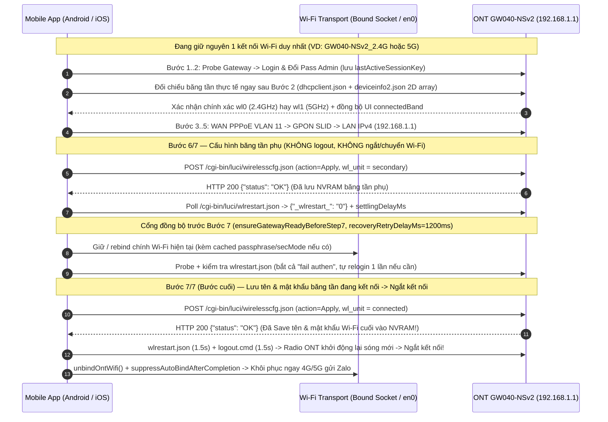

# Kế Hoạch: Giữ Kết Nối Wi-Fi Xuyên Suốt & Đảm Bảo Lưu Cấu Hình Wi-Fi Bước Cuối Trước Khi Ngắt Kết Nối Trên App Mobile (Android & iOS)

## Overview

Qua đối chiếu gói tin thực tế của **VNPT iGate GW040-NSv2** (`ont-040NSv2-setup.jsonl`: `seq: 4` `jquery.min.js`, `seq: 5` `login.js`, `seq: 37` bảng định tuyến LuCI, `seq: 69` `summary.js`, `seq: 73` `deviceinfo2.json`, `seq: 74` `dhcpclient.json`, `seq: 181` `wireless.js`, `seq: 214–228` `wirelesscfg.json` & `wlrestart.json`) và mã nguồn Mobile hiện tại (`android-app/` & `ios-app/`):

1. **Hành vi phần cứng & LuCI CGI thực tế trên ONT GW040-NSv2:**
   - `POST /cgi-bin/luci/wirelesscfg.json` (`luci.controller.main:wirelesscfg`) **có `action=Apply`** là lệnh duy nhất ghi SSID, chế độ bảo mật và mật khẩu vào NVRAM (~200ms $\rightarrow$ trả về `HTTP 200 {"status": "OK"}` tại `seq: 214`, `226`), đồng thời kích hoạt tiến trình `wlmngr` nạp lại cấu hình không dây dưới nền. (Nếu gọi không có `action=Apply` như `seq: 216`, `219`, ONT chỉ đọc NVRAM chứ không lưu).
   - `POST /cgi-bin/luci/wlrestart.json` (`luci.controller.main:wlcfg_ok`, payload `undefined&sessionKey=...` theo `wireless.js:158-164` trong `ont-040NSv2-setup.jsonl:361` và `seq: 215`) là API đọc cờ trạng thái `{"_wlrestart_": "0" | "1"}` để chờ `wlmngr` hoàn tất trước khi thao tác băng tần tiếp theo.

2. **Bốn nguyên nhân trực tiếp khiến App Mobile hiện đang bị ngắt kết nối TRƯỚC KHI hoàn thành cấu hình Wi-Fi cuối:**
   - **Nguyên nhân 1 — Tự động `logout()` & ngắt Wi-Fi hiện tại để nhảy sóng phụ (Band-Hopping Handover) trước Bước 7 (`OntMobileDriver.kt:1230-1256`, `MainViewModel.kt:840-861`, `OntWifiConnector.kt:414`):** Ngay sau Bước 6, ứng dụng Android chủ động gọi `logout()` và `unbindOntWifi()` để ép máy quét/bắt sang sóng phụ mới đổi (`WifiNetworkSpecifier`). Trên Android 10–14, hộp thoại ghép nối hoặc quá trình quét 5GHz thường xuyên timeout (15–25s) hoặc thất bại trên máy chỉ hỗ trợ 2.4GHz $\rightarrow$ điện thoại mất kết nối hoàn toàn **trước khi Bước 7 kịp gửi lệnh lưu Wi-Fi cuối**. (Ngược lại, ở chế độ 8 bước nạp Firmware tại `OntMobileDriver.kt:1103-1139`, việc **không chuyển sóng** mà giữ nguyên kết nối hiện tại sau Bước 6 đã chứng minh truyền tải ổn định file Firmware 30 MB).
   - **Nguyên nhân 2 — Nhận diện nhầm băng tần đang kết nối (`2.4GHz` vs `5GHz`) khiến Bước 6 đổi nhầm chính sóng đang nuôi kết nối (`OntWifiConnector.kt:677-705`, `MainViewModel.swift:320`):** Trên Android 12+ (`WifiNetworkSpecifier` hoặc tắt GPS), `wifiManager.connectionInfo.frequency` trả về `-1` và fallback cứng về `2.4GHz`; trên iOS, Apple chặn đọc SSID/tần số nếu không có gói Developer trả phí nên phụ thuộc hoàn toàn vào nút gạt tay `2.4GHz / 5GHz`. Nếu điện thoại thực tế đang bắt sóng `5GHz` (`wl1`), Bước 6 sẽ đổi tên luôn sóng `5GHz` đang kết nối $\rightarrow$ rớt mạng ngay tại Bước 6.
   - **Nguyên nhân 3 — Thiếu cổng kiểm tra sẵn sàng (`ensureGatewayReadyBeforeStep7`) trước Attempt 1 của Bước 7, lỗi lồng `try/catch` gọi đúp đăng nhập & bỏ sót `"fail authen"` (`OntMobileDriver.kt:659-683, 1270`, `OntMobileDriver.swift:639-684, 858`):** Ở chế độ 7 bước, cả Android và iOS đều nhảy thẳng vào Bước 7 Attempt 1 mà không đồng bộ lại kết nối/phiên sau đợt reload của Bước 6; ngoài ra `ensureGatewayReadyBeforeStep7` chưa nhận diện phản hồi hết hạn phiên `{"status": "fail authen"}` của LuCI, bị lồng `reloginAfterRadioBounce` trong `catch (_: Exception)` gây gọi đúp login chạm khóa phần cứng 180s (`[Red Team RT-01]`), và gắn cứng ngưỡng delay hồi phục vào `settlingDelayMs >= 500` (`[Red Team RT-03]`).
   - **Nguyên nhân 4 — Chưa theo dõi byte POST (`allBytesFlushed`) và bỏ qua kiểm tra sóng cũ còn sống ở Attempt 3 Bước 7 (`OntMobileDriver.kt:165-186, 539-547, 1282-1336`):** Nếu socket đứt trước khi toàn bộ body `wirelesscfg.json` kịp đẩy xuống hoặc cả 3 lần thử ở Bước 7 đều ngắt giữa chừng khi sóng cũ vẫn chưa đổi, nhánh `step7Attempt == 3` có nguy cơ báo `SUCCESS` giả (`[Red Team RT-04]`).

---

## Scope Challenge Summary

- **Existing code reusable:**
  - Luồng giữ kết nối + `ensureGatewayReadyBeforeStep7()` + `reloginAfterRadioBounce()` đã có sẵn trong `OntMobileDriver.kt:592-694, 1103-1124`.
  - Cơ chế đếm byte đẩy xuống socket (`RequestBody.writeTo` + `AtomicBoolean` trong `OntMobileDriver.kt:773-782`, và `didSendBodyData` tại `UnsafeSslSession.swift:124-137` $\rightarrow$ `didFlushFullRequestBody` tại `UnsafeSslSession.swift:61-91`).
  - Cả Android (`LinkProperties`) và iOS (`IosWifiMonitor.inspectInterfaces().en0IpAddress`) đều đọc được địa chỉ IPv4 nội bộ `192.168.1.x` của điện thoại mà không cần quyền GPS hay Apple Entitlement trả phí.
- **Requested scope:** Giữ nguyên kết nối Wi-Fi đang kết nối từ Bước 1 đến hết Bước 7 trên Mobile (Android & iOS), xác định chính xác băng tần đang kết nối để đặt ở Bước 7 cuối cùng, chỉ ngắt kết nối sau khi lệnh Save (`wirelesscfg.json` `action=Apply`) của bước cuối đã được đẩy/lưu thành công vào NVRAM ONT, và giữ tương thích 100% với chế độ 8 bước nạp Firmware cùng 6 chuẩn bảo mật Wi-Fi.
- **Complexity:** Gỡ bỏ mã chết Band-Hopping phức tạp (~180 dòng trên Android), củng cố driver & tầng Wi-Fi trên Android + iOS kèm bộ kiểm thử tự động & tài liệu hướng dẫn trong 3 Phase gọn nhẹ; không thêm thư viện ngoài.
- **Selected mode:** `HOLD SCOPE` (Full requested scope + Red Team Review).

---

## Brainstorm Contract

- **Outcome:** App Mobile (Android & iOS) duy trì xuyên suốt 1 kết nối Wi-Fi hiện tại từ Bước 1 đến Bước 7; tự động đối chiếu băng tần thực tế của điện thoại với ONT ngay sau Bước 2 (`dhcpclient.json` + `deviceinfo2.json` mảng 2 chiều) để luôn đặt băng tần đang kết nối ở Bước 7 cuối cùng; Bước 7 đảm bảo lưu xong SSID & mật khẩu mới vào NVRAM trước khi radio khởi động lại làm ngắt kết nối.
- **Constraints:**
  - Tuân thủ tuyệt đối giao thức LuCI CGI gốc của GW040-NSv2 (`wirelesscfg.json` có `action=Apply`, `wlrestart.json`, `logout.cmd`, `dhcpclient.json`, `deviceinfo2.json`).
  - Giữ nguyên tương thích 100% với chế độ 8 bước nạp Firmware trên Android (`[Red Team RT-07]` giữ cách ly flash khi đóng sheet) và 6 chế độ bảo mật Wi-Fi (`wpa2_wpa3_psk`, `wpa2_psk`, `wpa_wpa2_psk`, `wpa3_psk`, `wpa_psk`, `open`).
  - Không yêu cầu quyền mới trên Android hay Apple Developer Entitlement trả phí trên iOS; không đăng ký `WifiNetworkSuggestion` cho sóng Open xuất xưởng của ONT để tránh hộp thoại thu hồi quyền `CHANGE_WIFI_STATE` trên Android 11+ và tránh lưu profile Open tự bắt lại (`[Red Team RT-06]`).
- **Non-goals:** Không tự động ép điện thoại chuyển sang mạng Wi-Fi mới sau khi hoàn tất Bước 7 (giữ nút tùy chọn *"Kết nối vào Wi-Fi mới để kiểm tra mạng"* do KTV chủ động bấm và ưu tiên khôi phục 4G/5G để gửi báo cáo Zalo).
- **Acceptance criteria:**
  1. Bước 6 lưu thành công băng tần phụ mà **không gọi `logout.cmd`**, **không gỡ bind Wi-Fi** và **không nhảy sóng** sang băng tần phụ.
  2. Hệ thống tự động phát hiện đúng băng tần thực tế điện thoại đang bám giữ ngay sau Bước 2 (kể cả khi Android tắt GPS hoặc KTV dùng iPhone quên gạt nút chọn `5GHz` khi bắt sóng `5G`).
  3. Bước 7 chỉ chạy trên kết nối đã xác nhận sẵn sàng (`ensureGatewayReadyBeforeStep7` kiểm tra cả `"fail authen"` và không gọi đúp login), đảm bảo lệnh `wirelesscfg.json` (`action=Apply`) lưu NVRAM thành công (`HTTP 200 {"status": "OK"}` hoặc đã flush đủ 100% POST body và xác nhận sóng cũ đã tắt trên cả 3 lần thử `1..3`) rồi mới ngắt kết nối và khôi phục 4G/5G.
  4. Toàn bộ test suite (`./gradlew testDebugUnitTest` trên Android và `pytest` bao gồm parity tests cho Desktop & iOS) PASS 100%.

---

## Goals

| # | Goal | Priority |
|---|------|----------|
| 1 | Loại bỏ hoàn toàn Band-Hopping Handover trên Android; giữ nguyên kết nối Wi-Fi hiện tại từ Bước 1 đến Bước 7 kèm cổng kiểm tra `ensureGatewayReadyBeforeStep7` an toàn chống khóa 180s và xác thực lưu NVRAM chặt chẽ ở cả 3 lần thử Bước 7 | P1 |
| 2 | Bổ sung nhận diện băng tần kết nối thực tế từ phía ONT ngay sau Bước 2 (`dhcpclient.json` + `deviceinfo2.json` mảng 2 chiều) kết hợp `NetworkCapabilities.transportInfo` (Android 12+) cho cả Android và iOS để không bao giờ đổi nhầm sóng đang kết nối ở Bước 6 | P1 |
| 3 | Đồng bộ cơ chế giữ kết nối, tách tham số `recoveryRetryDelayMs`, khôi phục phiên `reloginAfterRadioBounce` (`lastActiveSessionKey`) trên iOS, cập nhật toàn bộ Unit Tests / Parity Tests và tài liệu hướng dẫn vận hành | P1 |

---

## Architecture & Sequence Flow

---

## Cross-Plan Dependencies

| Relationship | Plan | Status |
|-------------|------|--------|
| None | — | — |

---

## Phases

| # | Phase | Status |
|---|-------|--------|
| 1 | [Phase 1: Android Single-Connection Keep-Alive, Band Ground-Truth & Save-Before-Disconnect](./phase-01-start.md) | Completed |
| 2 | [Phase 2: iOS Native Keep-Alive, Server-Side Band Resolution & Session Recovery Parity](./phase-02-ios-keepalive-and-band-resolution.md) | Completed |
| 3 | [Phase 3: Automated Unit/Parity Tests & Field Documentation Cleanup](./phase-03-tests-and-docs.md) | Completed |

---

## Success Criteria

- [x] Trên Android, luồng 7 bước giữ nguyên kết nối Wi-Fi hiện tại xuyên suốt Bước 1–7: xóa sạch `onSwitchToConfiguredWifi`, `switchToSecondaryWifiAndAuthenticate`, `switchToConfiguredOntWifi`, `isSystemConnectedToTargetWifi` và toàn bộ nhánh `hasSwitchedToSecondaryBand` (`MainViewModel.kt:780-817, 840-861`) — clean cutover, không để lại mã chết (`[Red Team RT-09]`).
- [x] Ngay sau Bước 2 (trước khi `savelanv4cfg.cmd` chạm tới `br-lan`/`dnsmasq`), cả `OntMobileDriver.kt` và `OntMobileDriver.swift` thực thi `resolveConnectedBandFromOnt` (dùng client thường `requestTimeoutMs` / `3000ms`, phân tích đúng mảng 2 chiều `wirelessInfoList` của `deviceinfo2.json` có cắt `\r\n`, ưu tiên `wlAssociatedDevice` hơn `dhcpInfoList`, chuẩn hóa `wl0.1` $\rightarrow$ `wl0`, bỏ qua `"sessionKey": "0"`, và báo ngược `onBandResolved` lên UI `[Red Team RT-02, RT-05]`).
- [x] Trên Android 12+ (`API 31+`), `OntWifiConnector.detectConnectedBand()` đọc ưu tiên `NetworkCapabilities.transportInfo` (`WifiInfo.frequency`), `connectToOntWifi()` lưu đệm `lastSelectedPassphrase` / `lastSelectedSecurityMode` / `frequencyMhz` phục vụ `onRebindWifiNetwork` mà **không** đăng ký `WifiNetworkSuggestion` cho sóng Open xuất xưởng (`[Red Team RT-06]`), và yêu cầu `boundWifiNetwork != null` trước khi `RUN` để không rò lưu lượng sang 4G/VPN (`[Red Team RT-08]`).
- [x] Tách tham số `recoveryRetryDelayMs = 1200` độc lập với `settlingDelayMs` trên cả Android (`settlingDelayMs = 400L`) và iOS (`settlingDelayMs = 200`) để không vô tình rơi vào nhánh fast-forward `20ms` của unit test trong môi trường thật (`[Red Team RT-03]`).
- [x] `ensureGatewayReadyBeforeStep7` trên cả Android và iOS bọc `try/catch` hẹp quanh `postForm`, không gọi đúp `reloginAfterRadioBounce` (tránh khóa phần cứng 180s), phát hiện `{"status": "fail authen"}` để tự đăng nhập lại bằng `lastActiveSessionKey` động, và không nuốt `CancellationException` / `CancellationError` (`[Red Team RT-01, RT-05]`).
- [x] Ở Bước 7 (và Bước 8 thủ công `executeManualConnectedWifiOnly`), gỡ bọc `FlushTrackedIOException.cause` trước khi kiểm tra kiểu ngoại lệ, gọi `sink.flush()` trước `allBytesFlushed.set(true)`, kiểm tra `stillOnOldWifi = ensureGatewayReadyBeforeStep7` ở **cả 3 lần thử (`1..3`)** để chặn tuyệt đối lỗi báo `SUCCESS` giả khi sóng cũ vẫn còn sống, và bỏ qua 4.7s chờ `onVerifyNewSsid` khi `cfgSavedToNvram == true` (`[Red Team RT-04]`).
- [x] Sau khi hoàn tất Bước 7 hoặc Bước 7/8 nạp Firmware, `suppressAutoBindAfterCompletion` giữ nguyên `true` kể cả khi đóng `ExecutionProgressSheet` (chỉ mở lại khi KTV chủ động chọn thuê bao khác, mở quét Wi-Fi, bấm kết nối Wi-Fi mới, hoặc bấm RUN / Bước 8 thủ công) để bảo toàn mạng 4G/5G xuất Zalo và cách ly ONT đang ghi flash (`[Red Team RT-07]`).
- [x] Toàn bộ test suite (`./gradlew testDebugUnitTest` trên Android và `pytest` cho Desktop & iOS parity) chạy PASS 100%.

---

## Red Team Review

### Session — 2026-11-03
**Reviewers:** 3 Hostile Personas (`SecurityAdversary`, `FailureModeAnalyst`, `AssumptionDestroyer`) — Standard Verification Tier (`Fact Checker` + `Contract Verifier`)
**Findings:** 9 (9 accepted, 0 rejected — all backed by codebase & `ont-040NSv2-setup.jsonl` `file:line` evidence)
**Severity breakdown:** 5 Critical, 3 High, 1 Medium

| # | Finding | Severity | Disposition | Applied To |
|---|---------|----------|-------------|------------|
| RT-01 | `ensureGatewayReadyBeforeStep7` (`OntMobileDriver.kt:659-683`, `OntMobileDriver.swift:655-676`) nests `reloginAfterRadioBounce` inside `catch (_: Exception)` causing double-login 180s hardware lockout (`numberLogin` $2 \rightarrow 3$), misses LuCI's `{"status": "fail authen"}` JSON expiry (`ont-040NSv2-setup.jsonl:14`), and swallows coroutine/task cancellation | Critical | Accept | `plan.md`, `phase-01`, `phase-02`, `phase-03` |
| RT-02 | `resolveConnectedBandFromOnt` (`ont-040NSv2-setup.jsonl:135,140,151,152`) faces a nested 2D `wirelessInfoList` array `[[String, String]]` with trailing `\n` & `"0\n"` (`auto`), `1,372 ms` `deviceinfo2.json` latency exceeding `1.5s` `logoutClient`/`logoutSession`, stale `dhcpInfoList` leases vs live `wlAssociatedDevice`, and post-Step-5 `savelanv4cfg.cmd` `dnsmasq` reload race | Critical | Accept | `plan.md`, `phase-01`, `phase-02`, `phase-03` |
| RT-03 | Lowering `settlingDelayMs` below `500` (`400L` in `MainViewModel.kt`, `200` in `MainViewModel.swift:348`) trips the unit-test fast-forward threshold (`if (settlingDelayMs >= 500) 1200 else 20` at `OntMobileDriver.kt:1111,1285,1318` & `OntMobileDriver.swift:872,903`), shrinking production radio-recovery windows from `9.6s` to `160ms` | Critical | Accept | `plan.md`, `phase-01`, `phase-02`, `phase-03` |
| RT-04 | Step 7 Attempt 3 (`OntMobileDriver.kt:1284,1330`, `OntMobileDriver.swift:871,915`, `executeManualConnectedWifiOnly` at `:1456`) skips `stillOnOldWifi` verification and reports false `SUCCESS`; `FlushTrackedIOException` breaks `e is <Subtype>` checks in `isPreSendConnectFailure`/`isPostFlushRadioDrop`; `NSURLErrorSecureConnectionFailed` is misclassified on iOS (`:716`); and `onVerifyNewSsid` wastes `4.7s` when `cfgSavedToNvram == true` | Critical | Accept | `plan.md`, `phase-01`, `phase-02`, `phase-03` |
| RT-05 | Static `preStep6SessionKey`/`step6SessionKey` (`OntMobileDriver.kt:1092,1101,1289,1323`), destructive `logout()` key wipe on timeout (`:965`), missing `previousSessionKey` at `OntMobileDriver.swift:873,905`, and rotating placeholder `"sessionKey": "0"` (`ont-040NSv2-setup.jsonl:52`) break `"user exist"` 60s recovery | Critical | Accept | `plan.md`, `phase-01`, `phase-02`, `phase-03` |
| RT-06 | Registering `temporaryOntSuggestions` in `connectToOntWifi()` (`OntWifiConnector.kt:226-259`) self-deletes at `:254`, triggers Android 11+ permission dialogs where dismissal revokes `CHANGE_WIFI_STATE`, and persists Open evil-twin auto-join profiles; meanwhile `onRebindWifiNetwork` (`MainViewModel.kt:827-831`) drops `passphrase`, `securityMode`, and `frequencyMhz` | High | Accept | `plan.md`, `phase-01` |
| RT-07 | Clearing `suppressAutoBindAfterCompletion` inside `dismissExecutionSheet()` (`MainViewModel.kt:959-962`) violates `[RT-01]` 8-step firmware flash isolation and breaks 4G/5G Zalo export from `SubscriberListScreen`, while `ExecutionProgressSheet.kt:507-527` hardcodes `newSsid24g` for Join New Wi-Fi and `MainViewModel.swift` lacks post-completion probe suppression | High | Accept | `plan.md`, `phase-01`, `phase-02` |
| RT-08 | Null `boundWifiNetwork` fallback to `SocketFactory.getDefault()` (`UnsafeSslClient.kt:46-50`, `MainViewModel.kt:186-190,735,1006`) risks routing unverified TLS over 4G/VPN, iOS `runOntConfiguration()` (`MainViewModel.swift:297`) skips `isOnOntSubnet` precheck, and GPS-off `<unknown ssid>` renders `"Chưa bắt Wi-Fi ONT"` while ONLINE (`SubscriberListScreen.kt:381`) | High | Accept | `plan.md`, `phase-01`, `phase-02` |
| RT-09 | Contract & line-citation alignment: place `localWifiIpv4` / `onBandResolved` before trailing `onProgress` closure (`MainViewModel.kt:865`, `MainViewModel.swift:363`, `OntMobileDriverTest.kt:348`), remove `MainViewModel.kt:780-817` (`if (hasSwitchedToSecondaryBand)`) & `OntMobileDriverTest.kt:838`, update all 3 `try await ensureGatewayReadyBeforeStep7` callsites in `OntMobileDriver.swift`, and align `wireless.js:158-164` / `OntMobileDriver.kt:165-186` / `UnsafeSslSession.swift:124-137` citations | Medium | Accept | `plan.md`, `phase-01`, `phase-02`, `phase-03` |

### Whole-Plan Consistency Sweep
- **Files reread:** `plan.md`, `phase-01-start.md`, `phase-02-ios-keepalive-and-band-resolution.md`, `phase-03-tests-and-docs.md`
- **Decision deltas checked:** 9 (`RT-01` through `RT-09`)
- **Reconciled stale references:** 9 (removed `temporaryOntSuggestions` from `phase-01` Requirements, Steps, Todo, and Risk Assessment in favor of `lastSelectedPassphrase`/`lastSelectedSecurityMode` caching in `OntWifiConnector`; moved `resolveConnectedBandFromOnt` from post-Step-5 to immediately after Step 2 using normal/3000ms timeout and 2D `wirelessInfoList` parsing across `plan.md`, `phase-01`, `phase-02`, and `phase-03` test fixtures; decoupled `recoveryRetryDelayMs = 1200` from `settlingDelayMs` in `phase-01` and `phase-02`; enforced `stillOnOldWifi` check across all 3 attempts `1..3` and in `executeManualConnectedWifiOnly`; preserved `suppressAutoBindAfterCompletion = true` across `dismissExecutionSheet()` and added `ExecutionProgressSheet.kt` + `SubscriberListScreen.kt` to `phase-01` Related Code Files; placed new `executeMobileSetup` parameters before trailing `onProgress` lambda/closure on both platforms)
- **Unresolved contradictions:** 0

<!-- slug: mobile-wifi-keepalive-save-final -->
