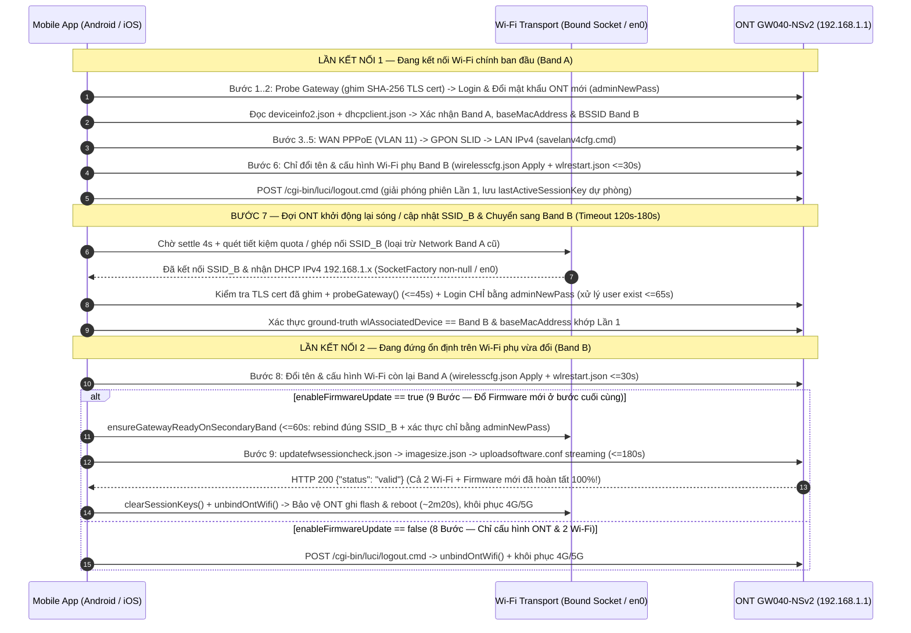

# Kế Hoạch: Cấu Hình Hoàn Tất Cả 2 Wi-Fi & Đổ Firmware Mới Qua Quy Trình 2 Lần Kết Nối Tự Động Trên App Mobile (Android & iOS)

## Overview

Trên phần cứng **VNPT iGate GW040-NSv2**, quy trình 1 lần kết nối hiện tại (`OntMobileDriver.kt:1368-1553`, `OntMobileDriver.swift:1117-1305`) gặp giới hạn vật lý: nếu nạp Firmware trước thì ONT tự ghi flash và khởi động lại (~2 phút 17 giây) khi **Wi-Fi chính vẫn chưa được đổi tên** (`manualWifiStepPending = true`); nếu đổi Wi-Fi chính trước trên cùng kết nối thì sóng đứt ngay lập tức nên **không thể tải Firmware lên**.

Kế hoạch này thiết kế lại luồng thực thi thống nhất **2 lần kết nối (Two-Connection Handover + Final Firmware Update)** trên cả **Android (`android-app/`)** và **iOS (`ios-app/`)** với ngân sách timeout đủ dài theo đúng hành vi thực tế từ gói tin capture (`ont-040NSv2-setup.jsonl`, `update_firmware_040nsv2.jsonl`):
1. **Lần kết nối 1 (trên Wi-Fi chính ban đầu `Band A`):** Kiểm tra Gateway + ghim chứng chỉ TLS SHA-256 của ONT (`[Red Team RT-04]`) $\rightarrow$ Đăng nhập & đổi mật khẩu Admin ONT mới (`adminNewPass`) + luôn đọc `deviceinfo2.json` & `dhcpclient.json` xác thực `Band A` và `baseMacAddress` (`[Red Team RT-02]`) $\rightarrow$ Cấu hình WAN PPPoE $\rightarrow$ GPON SLID $\rightarrow$ LAN IPv4 $\rightarrow$ **Chỉ đổi tên & cấu hình Wi-Fi phụ (`Band B`)** (`wirelesscfg.json` `action=Apply` + chờ `wlrestart.json` tối đa `30s`) $\rightarrow$ Đăng xuất sạch `logout.cmd` (vẫn lưu `lastActiveSessionKey` dự phòng). *(Riêng trên máy Android đời cũ chỉ có phần cứng 2.4GHz `!is5GHzBandSupported()`, Lần 1 cấu hình cả `5GHz` rồi đổi `2.4GHz`, Lần 2 tự kết nối lại vào `2.4GHz` mới để nạp Firmware bước cuối `[Red Team RT-08]`).*
2. **Đợi ONT khởi động lại sóng / cập nhật tên Wi-Fi sau Lần 1 & Tự chuyển kết nối sang Wi-Fi phụ vừa đổi (`Band B`):** Ngân sách chờ dài (`wifiHandoverTimeoutMs = 120_000 ms` trên Android / `180_000 ms` theo wall-clock `Date()` trên iOS) để chờ Broadcom `wlmngr` / `acsd` / kênh 5GHz DFS (`100/120`) phát sóng `SSID_B` và hoàn tất khởi động dịch vụ sau Lần 1, tự động ghép nối sang `SSID_B` bằng mật khẩu Wi-Fi mới, kiểm tra chữ ký TLS đã ghim + `probeGateway()` (`45s`), đăng nhập lại vào ONT **chỉ bằng mật khẩu Admin ONT mới** (tự giải phóng `"user exist"` bằng `lastActiveSessionKey` hoặc chờ tối đa `65s` hết TTL phiên cũ, tuyệt đối không thử lại pass `"admin"` cũ `[Red Team RT-01]`), và xác thực ground-truth `wlAssociatedDevice` đã đứng trên `Band B` của đúng ONT (`baseMacAddress`) bất kể 2 băng tần đặt tên khác nhau hay trùng nhau (`[Red Team RT-02]`).
3. **Lần kết nối 2 (đang đứng trên Wi-Fi phụ `Band B`):** **Đổi tên & cấu hình Wi-Fi còn lại (`Band A`)** (có kiểm tra NVRAM read-only `page=ssid.asp&wl_unit=$primaryUnit&wl_bssid=0` + `wlrestart.json` nếu rớt gói `[Red Team RT-02]`), chạy cổng đồng bộ `ensureGatewayReadyOnSecondaryBand` (`postSecondWifiSettleTimeoutMs = 60_000 ms`, rebind đúng `SSID_B` và chỉ đăng nhập bằng `adminNewPass` `[Red Team RT-01, RT-03]`), và thực hiện **bước cuối cùng là Update Firmware** (`updatefwsessioncheck.json` $\rightarrow$ `imagesize.json` $\rightarrow$ `uploadsoftware.conf` streaming với `firmwareUploadTimeoutMs = 180_000 ms`), xóa ngay `sessionKey` khi nhận `"status": "valid"` (hoặc sau khi đã flush 100% file bất kể app ở nền hay tiền cảnh `[Red Team RT-05]`) và giải phóng Wi-Fi để ONT ghi flash + khởi động lại an toàn với **cả 2 Wi-Fi và Firmware mới đã hoàn tất 100%**.

---

## Brainstorm Contract & Scope Challenge

- **Outcome:** App Mobile (`android-app` & `ios-app`) hoàn thành trọn vẹn 3 việc trong 1 lần bấm `RUN`: cấu hình xong cả 2 băng tần Wi-Fi (`2.4GHz` & `5GHz`) và đổ xong Firmware mới ở bước cuối cùng thông qua 2 lần kết nối tuần tự, loại bỏ hoàn toàn bước đổi Wi-Fi thủ công sau khi ONT reboot.
- **Constraints:**
  - Ngân sách timeout đủ dài ở mọi điểm chờ phần cứng (tách riêng tham số constructor `wlRestartPollIntervalMs`, `maxWlRestartPolls`, `userExistPollIntervalMs` để không bao giờ trộn ngưỡng test với `settlingDelayMs` `[Red Team RT-05]`): `wlrestart.json` poll `30 × 1000 ms` (khớp `wireless.js`), Handover sau Lần 1 `120s` (Android) / `180s` (iOS), Gateway probe sau chuyển sóng `45s`, xử lý `"user exist"` tối đa `65s`, đồng bộ radio sau khi đổi Wi-Fi thứ 2 `60s`, tải lên Firmware `180s`, và hướng dẫn/đếm ngược chờ ONT ghi flash + reboot `150s`.
  - Android (`minSdk = 26`, `targetSdk = 34`): kiểm tra tương thích chế độ bảo mật (`wpa_psk` trên API 29+ / `wpa3_psk` trên máy thiếu SAE hoặc API 26–28) ngay trước Bước 1 (`[Red Team RT-06]`); quản lý hạn mức 4 lần `startScan()` / 120s toàn tiến trình (`[Red Team RT-09]`); không gọi `WifiNetworkSuggestion` đồng thời với `WifiNetworkSpecifier`; chặn rò lưu lượng sang `Band A` cũ hoặc 4G/5G khi tắt GPS / `onLost` (`[Red Team RT-03]`); và hỗ trợ cả máy chỉ có 2.4GHz (`[Red Team RT-08]`).
  - iOS (`iOS 16.0+`, pure Swift, zero SPM/CocoaPods): giữ nguyên khả năng cài `.ipa` miễn phí qua Sideloadly/AltStore (`CODE_SIGNING_ALLOWED=NO`, không thêm `.entitlements` trả phí); cập nhật đồng bộ cả `project.yml` và `project.pbxproj` (`[Red Team RT-10]`); dùng `FileProtectionType.completeUntilFirstUserAuthentication`, làm mới `beginBackgroundTask` khi quay lại app, tạm dừng poll `login.cmd` dưới nền khi chưa đổi mạng, và giữ `.localOnly: true` (`120s`) cho `UIPasteboard` trên `@MainActor` (`[Red Team RT-07]`).
- **Non-goals:** Không sửa mã nguồn bản Desktop Windows (`app/`) chạy qua cáp LAN; không đổi cấu trúc 30 cột gốc của `file-mau.xlsx`.
- **Selected Scope Mode:** `HOLD SCOPE` (Full requested scope, 4 phases, `--hard` mode with Red Team Review).

---

## Architecture & Sequence Flow

---

## Cross-Plan Dependencies

| Relationship | Plan | Status |
|-------------|------|--------|
| None | — | — |

---

## Goals

| # | Goal | Priority |
|---|------|----------|
| 1 | Xây dựng bộ chuyển sóng Wi-Fi phụ an toàn (`OntWifiConnector.kt`), ghim TLS cert liên kết nối (`UnsafeSslClient.kt`), và máy trạng thái 2 lần kết nối + nạp Firmware bước cuối (`OntMobileDriver.kt`) với timeout dài chống rớt/khóa phiên | P1 |
| 2 | Cập nhật `MainViewModel.kt`, `MainActivity.kt`, `ConfigReviewScreen.kt`, `ExecutionProgressSheet.kt` hiển thị tiến trình 8/9 bước trực quan, kiểm tra tương thích bảo mật trước Bước 1, rebind động đúng `SSID_B` ở Lần 2 và xóa bỏ hoàn toàn luồng đổi Wi-Fi thủ công cũ | P1 |
| 3 | Đồng bộ toàn diện sang bản iOS Native (`ios-app/`): bổ sung chọn/nạp Firmware streaming (`uploadMultipartFile`), chuyển sóng hybrid (`NEHotspotConfigurationManager` + Auto-Detect `180s` wall-clock an toàn dưới nền) và luồng 2 lần kết nối trên `OntMobileDriver.swift` | P1 |
| 4 | Cập nhật toàn bộ Unit Tests Android (`20` callsites), iOS (`11` callsites), `mock_luci_server.py`, bộ kiểm thử đối xứng `tests/test_ios_app_parity.py` và tài liệu `README.md` / `HUONG_DAN_SU_DUNG_TOOL_ONT.md` | P1 |

---

## Phases

| # | Phase | Status |
|---|-------|--------|
| 1 | [Phase 1: Android Wi-Fi Handover Engine & Two-Connection Firmware Driver](./phase-01-start.md) | Completed |
| 2 | [Phase 2: Android ViewModel, Dynamic Rebind & Compose Progress UI](./phase-02-android-viewmodel-and-compose-ui.md) | Completed |
| 3 | [Phase 3: iOS Native Two-Connection Handover & Streaming Firmware Parity](./phase-03-ios-handover-and-firmware-parity.md) | Completed |
| 4 | [Phase 4: Unit Tests, Cross-Platform Parity Suite & Field Documentation](./phase-04-tests-parity-and-docs.md) | Completed |

---

## Success Criteria

- [x] **Lần kết nối 1 (Bước 1–6):** Ghim SHA-256 chứng chỉ TLS của ONT, luôn đọc `deviceinfo2.json` + `dhcpclient.json` để xác thực đúng `Band A` và `baseMacAddress`, chỉ đổi tên & cấu hình Wi-Fi phụ (`Band B`), chờ `wlrestart.json` tối đa `30s`, và gọi `logout.cmd` giải phóng sạch phiên Lần 1 (bảo lưu `lastActiveSessionKey`).
- [x] **Chuyển kết nối tự động sang Wi-Fi phụ (Bước 7):** Chờ đủ dài (`120s` trên Android / `180s` wall-clock trên iOS) để ONT khởi động lại sóng & cập nhật tên Wi-Fi sau Lần 1 (kể cả kênh 5GHz DFS `100/120`), tự ghép nối vào `SSID_B` (không bám nhầm lại `Band A` khi tắt GPS, không rò sang 4G/5G), xác thực chứng chỉ TLS đã ghim + `probeGateway()` (`45s`), đăng nhập lại **chỉ bằng mật khẩu ONT mới (`adminNewPass`)** (tự xử lý `"user exist"` qua `lastActiveSessionKey` hoặc chờ tối đa `65s`, không bao giờ gửi `"admin"` cũ gây khóa 180s), và xác nhận `wlAssociatedDevice == Band B` + `baseMacAddress` khớp Lần 1.
- [x] **Lần kết nối 2 & Đổ Firmware bước cuối (Bước 8–9):** Đổi tên & lưu NVRAM thành công cho Wi-Fi còn lại (`Band A`); chạy cổng `ensureGatewayReadyOnSecondaryBand` (`60s`, chỉ dùng `adminNewPass` và rebind đúng `SSID_B`) trước khi gọi `updateFirmware()` (`180s` upload timeout) ở bước cuối cùng; xóa `sessionKey` ngay khi `"status": "valid"` (hoặc sau khi flush 100% file), ngắt bind Wi-Fi ONT để bảo vệ quá trình ghi flash + khởi động lại (~2m20s) và khôi phục 4G/5G xuất Excel trạng thái `OK` trọn vẹn (xóa sạch `manualWifiStepPending`, `executeManualConnectedWifiOnly`, `verifyNewSsidBroadcast`).
- [x] **Kiểm thử & Tài liệu:** `./gradlew testDebugUnitTest assembleDebug` (Android) chạy nhanh `< 15s` và PASS 100%; `PYTHONPATH=. pytest -v` (bao gồm `tests/test_ios_app_parity.py`) PASS 100%; `README.md` và `HUONG_DAN_SU_DUNG_TOOL_ONT.md` phản ánh chính xác quy trình mới.

---

## Red Team Review

### Session — 2026-11-05
**Reviewers:** 3 Hostile Personas (`SecurityAdversary`, `FailureModeAnalyst`, `AssumptionDestroyer`) — Standard Verification Tier (`Fact Checker` + `Contract Verifier`)
**Report:** [`reports/red-team-261105-mobile-dual-wifi-handover-firmware.md`](./reports/red-team-261105-mobile-dual-wifi-handover-firmware.md)
**Findings:** 10 (10 accepted, 0 rejected — 100% backed by codebase & `.jsonl` `file:line` evidence)
**Severity breakdown:** 6 Critical, 3 High, 1 Medium

| # | Finding | Severity | Disposition | Applied To |
|---|---------|----------|-------------|------------|
| RT-01 | Reusing `ensureGatewayReadyBeforeStep7` (`OntMobileDriver.kt:897 -> 347`, `OntMobileDriver.swift:925 -> 348`) in Steps 8–9 falls back to `adminDefaultPass` (`"admin"`) on socket resets, risking 180s hardware lockout | Critical | Accept | `plan.md`, `phase-01`, `phase-03`, `phase-04` |
| RT-02 | Read-only `wirelesscfg.json` (`ont-040NSv2-setup.jsonl:361,436,456`) needs `page=ssid.asp&wl_unit=<0\|1>&wl_bssid=0` & `nvramWlWpaPsk` masking; iOS `resolveConnectedBandFromOnt` (`:738-823`) omits `baseMacAddress`; `distinctSsids` / `nvramWlSsid` shortcuts pass Step 7 while still on `Band A` | Critical | Accept | `plan.md`, `phase-01`, `phase-03`, `phase-04` |
| RT-03 | Android GPS-off `hasActiveOntSubnetWifi()` (`OntWifiConnector.kt:256-302`), unconditional `onLost` unbind (`:322`), nullable `SocketFactory?` (`UnsafeSslClient.kt:47-51`), and `rebindOntWifiSocketFactory` (`MainViewModel.kt:715-738`) hijack Connection 2 back to `Band A` or 4G/5G | Critical | Accept | `plan.md`, `phase-01`, `phase-02`, `phase-04` |
| RT-04 | Unpinned trust-all TLS (`UnsafeSslClient.kt:17-21`, `UnsafeSslSession.swift:152-171`) leaks `adminNewPass`/`conn1SessionKey` to Evil-Twin or neighbor ONTs before `baseMacAddress` check; iOS `joinOnce = false` persists Open profiles | Critical | Accept | `plan.md`, `phase-01`, `phase-03`, `phase-04` |
| RT-05 | Direct `en0` check in `OntMobileDriver.swift`, `UnsafeSslSession` upload `protocolClasses`/retain leak/`isAppInBackground` guard (`:972`), `settlingDelayMs` branching (`test_ios_app_parity.py:328`), and `120s-180s` test defaults stall CI (`build-ios-ipa.yml:22`) | Critical | Accept | `plan.md`, `phase-01`, `phase-03`, `phase-04` |
| RT-06 | `wpa_psk` on Android 10+ (`OntWifiConnector.kt:189`), `wpa3_psk` on non-SAE / API 26–28 (`:181`), and `open` on iOS `NEHotspotConfiguration` fail Step 7 after Steps 1–6 already mutated ONT | Critical | Accept | `plan.md`, `phase-01`, `phase-02`, `phase-03` |
| RT-07 | iOS background `login.cmd` thrashing & unrenewed `beginBackgroundTask` (`MainViewModel.swift:345`), `FileProtectionType.complete` screen-lock I/O failure (`AppDatabase.swift:25`), and off-MainActor non-`.localOnly` pasteboard (`test_ios_app_parity.py:132`) | High | Accept | `plan.md`, `phase-03`, `phase-04` |
| RT-08 | Blocking `!is5GHzBandSupported()` (`build.gradle.kts:13`) bricks 2.4GHz-only Android phones instead of reconnecting to renamed `2.4GHz`; missing `defer` on `probePauseMutex` (`OntMobileDriver.swift:1144`) risks deadlock | High | Accept | `plan.md`, `phase-01`, `phase-02`, `phase-03` |
| RT-09 | Process-wide Android `startScan()` quota (`4 / 120s`) exhausted across Scanner Dialog (`MainViewModel.kt:593-609`), Phase A, and dead `verifyNewSsidBroadcast` (`OntWifiConnector.kt:565-605`) | High | Accept | `plan.md`, `phase-01`, `phase-02` |
| RT-10 | Omitted callers & files: `MainViewModel.kt:956`, `WifiGuideSheet.swift:120`, `project.pbxproj`, `mock_luci_server.py:212`, `test_ios_app_parity.py:106,336`, and Android `cacheDir/exports/` PII cleanup (`MainViewModel.kt:1141`) | Medium | Accept | `plan.md`, `phase-02`, `phase-03`, `phase-04` |

### Whole-Plan Consistency Sweep
- **Files reread:** `plan.md`, `phase-01-start.md`, `phase-02-android-viewmodel-and-compose-ui.md`, `phase-03-ios-handover-and-firmware-parity.md`, `phase-04-tests-parity-and-docs.md`
- **Decision deltas checked:** 10 (`RT-01` through `RT-10`)
- **Reconciled stale references:** 10 (replaced all post-Step-2 `ensureGatewayReadyBeforeStep7` references with `ensureGatewayReadyOnSecondaryBand` strictly using `authenticateSecondConnection` across `plan.md`, `phase-01`, `phase-03`, `phase-04`; removed `distinctSsids` bypass and iOS `nvramWlSsid == secondarySsid` handover fallback across `phase-01`, `phase-03`, `phase-04`; replaced `settlingDelayMs >= 100` branching with explicit `wlRestartPollIntervalMs` / `maxWlRestartPolls` / `userExistPollIntervalMs` constructor params; changed 2.4GHz-only Android handling from hard block to 2.4GHz rename-and-rejoin handover across `plan.md`, `phase-01`, `phase-02`; replaced `FileProtectionType.complete` and `300s` pasteboard copy on iOS with `completeUntilFirstUserAuthentication` and `@MainActor` `.localOnly: true` `120s` copy; added leaf TLS SHA-256 pinning, `onVerifyNewSsid`/`verifyNewSsidBroadcast` removal, `MainViewModel.kt:956`, `WifiGuideSheet.swift`, `project.pbxproj`, `mock_luci_server.py`, and all 20 Kotlin + 11 Swift test callsites).
- **Unresolved contradictions:** 0

<!-- slug: mobile-dual-wifi-handover-firmware -->
